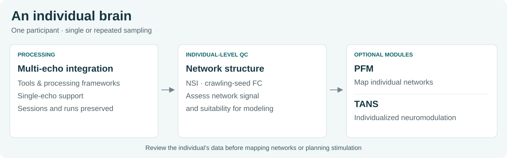
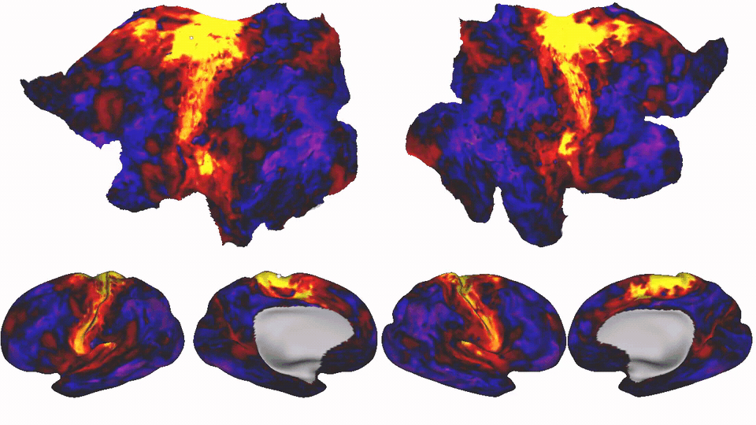
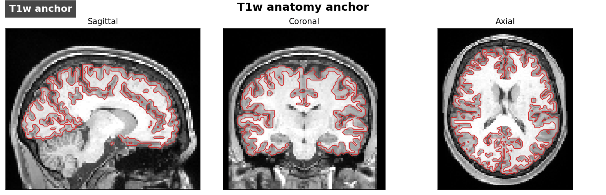
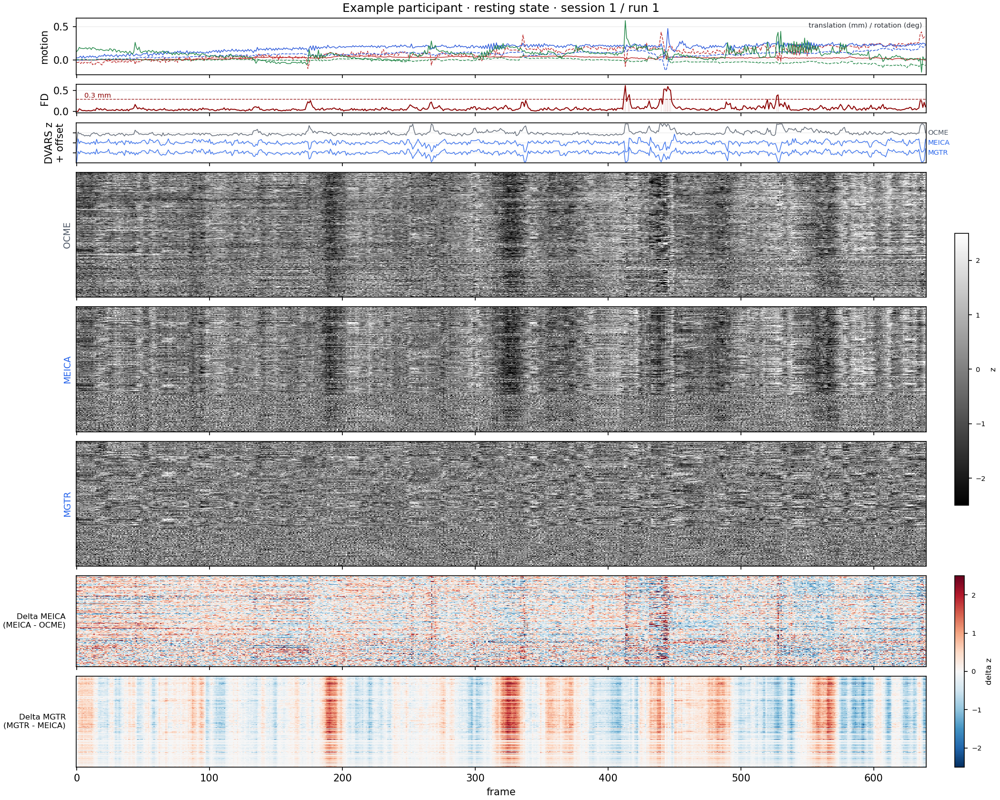

# pfm-mefmri

A pipeline for processing **individual resting-state and task fMRI data**, including
longitudinal data acquired across multiple sessions or visits. It integrates
multi-echo-specific tools and processing frameworks, with support for single-echo
acquisitions too.

Precision functional mapping (PFM) and individualized TMS targeting through
[TANS](https://github.com/cjl2007/pfm-tans) can be added at the end of processing.



## Review individual-level data quality

**Network Similarity Index (NSI)** quantifies how clearly an individual's
functional connectivity expresses large-scale network structure
([Lynch et al., 2026](https://www.cell.com/neuron/fulltext/S0896-6273%2826%2900412-5)).
**Crawling-seed FC maps** provide a quick visual review of that structure across
cortex. Together, they help assess whether the data support individual network
modeling.


*NSI-based estimate of PFM usability.*

[](docs/assets/qc-seed-fc.mp4)

*As the seed moves across cortex, its functional-connectivity map updates.
[Watch the full movie](docs/assets/qc-seed-fc.mp4); the looping preview samples
frames from the full cortical sweep.*



*Coregistration over time: cycle through 26 runs across 13 sessions to inspect
alignment consistency in a fast, repeating loop.*



*Run-level motion and signal review through denoising.*

[Full output gallery](docs/output-gallery.md) · [QC guide](docs/qc-modules.md).

## Optional precision functional mapping

**RidgePFM** combines individual functional connectivity with network priors.
Default weights: **FC = 1.0**, **spatial prior = 0.05**.


*Left: winner-take-all network maps. Right: the probabilistic / weighted map for
DMN-Parietal, showing its continuous network weights.*

[Mapping options and output files](docs/pfm-outputs.md). This example uses existing
pooled-data maps, not a rerun with the new default. Keep separate visit or epoch
analyses when studying change. [Repeat-sampling guidance](docs/individual-longitudinal-studies.md).

## Optional individualized neuromodulation

[TANS](https://github.com/cjl2007/pfm-tans) uses individual network maps and anatomy
to optimize coil position and orientation, explore modeled electric-field dose,
and export neuronavigation targets. It runs as an **optional final module** and
is installed separately.


*Separate SAL targeting example; this curated illustration includes schematic
search-history scores and an illustrative final placement.*

[Integration guide](docs/tans-integration.md) ·
[Configuration example](config/tans_module.example.sh) ·
[TANS GitHub](https://github.com/cjl2007/pfm-tans).

## Get started

1. Clone with `--recurse-submodules` and install the [dependencies](docs/dependencies.md).
2. Follow [configuration setup](docs/configuration.md) to copy the templates into
   your study folder and set software paths, acquisition settings, and optional modules.
3. [Import your data](docs/configuration.md#5-configure-import-and-prepare-inputs),
   validate one subject, then run:

```bash
bash /path/to/pfm-mefmri/bin/mefmri_pipeline.sh \
  /data/MyStudy/SUB001 /data/MyStudy/config/mefmri.sh
```

[Quick start](docs/quick-start.md) · [Workflow stages](docs/pipeline-overview.md) ·
[Output locations](docs/output-map.md) · [All guides](docs/README.md).

Research software. Review participant data quality and modeled outputs before
use; participant-derived figures require permission before public distribution.
