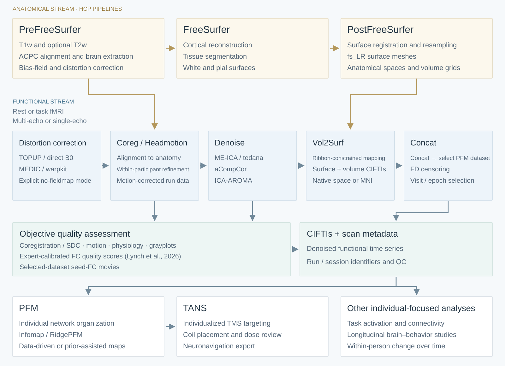
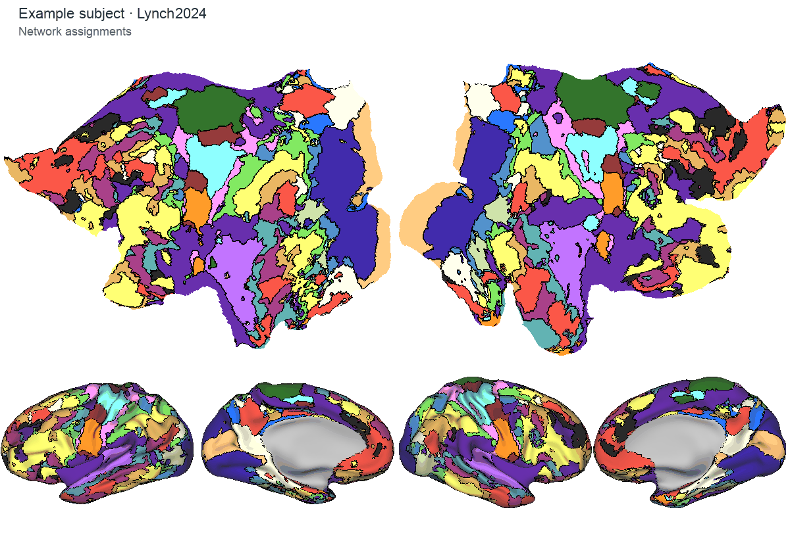

# pfm-mefmri

Precision functional mapping of individual human brains, from a single visit to densely sampled longitudinal studies.

The pipeline processes resting-state and task fMRI, supports multi-echo and single-echo acquisitions, and produces individual network maps with motion, physiology, alignment, and functional-connectivity quality control.



## Get started

1. Install the [dependencies](SOFTWARE_DEPENDENCIES.txt).
2. [Configure your project](docs/configuration.md), keeping project configuration outside the repository.
3. [Import the data](docs/setup-and-inputs.md#importing-inputs) and run:

```bash
bash /path/to/pfm-mefmri/bin/mefmri_pipeline.sh \
  /data/MyStudy/SUB001 /data/MyStudy/config/mefmri.sh
```

[Quick start](docs/quick-start.md) · [Workflow stages](docs/pipeline-overview.md) · [Output locations](docs/output-map.md)

## Precision Functional Mapping (PFM)

Precision functional mapping (PFM) encompasses methods for mapping brain networks in individuals, beyond group-average descriptions. We are developing RidgePFM to bring knowledge of network locations from foundational PFM studies into FC template matching, balancing the reliability supported by spatial priors with the retention of individual-specific network features.

Ridge regularization (λ) controls the FC template fit; spatial weight controls the influence of the prior. A conventional Infomap workflow is also available.

The example shows the CV-selected map (λ = 30, spatial weight = 0.1) on flat and inflated surfaces. The animation switches between network assignments and matching softmax maps.



[Explore this subject’s CV results](https://raw.githubusercontent.com/cjl2007/pfm-mefmri/main/docs/ridgepfm-cv-me01.zip) · [PFM guide](docs/pfm-outputs.md)

<details>
<summary>Softmax maps and other taxonomies</summary>

Softmax weights express relative model support and sum to one across networks at each location.

[Explore other network taxonomies](https://raw.githubusercontent.com/cjl2007/pfm-mefmri/main/docs/ridgepfm-taxonomy-explorer.zip): separate demonstrations of Lynch2024, Du2024, Hermosillo2024, and Kong2019, including winner-take-all labels, softmax maps, and optional areal parcels. Download and extract the ZIP, then open the HTML in a browser.

</details>

### Choosing RidgePFM parameters

The balance between individual FC and the population spatial prior depends on the data available and the desired reliability of network maps.

1. [Tradeoffs of incorporating spatial priors](docs/ridgepfm-spatial-priors.md): see how parameters change the maps and the balance between reliability and individual-specific information.
2. [Reasonable ranges for ~30 minutes or multiple hours](docs/ridgepfm-parameter-ranges.md): general guidance on a suitable starting point.
3. [Select parameters within each subject using CV](docs/ridgepfm-cv-selection.md): compare held-out FC profile homogeneity and reliability of network maps. [View an example subject](https://raw.githubusercontent.com/cjl2007/pfm-mefmri/main/docs/ridgepfm-cv-me01.zip).

<a id="data-organization"></a>

## Further guides

| Guide | Contents |
| --- | --- |
| [Data organization](docs/data-organization.md) | Expected inputs and example outputs across runs and visits. |
| [Quality control](docs/output-gallery.md) | Motion, physiology, FC quality, crawling-seed movies, and alignment. |
| [Processing](docs/pipeline-overview.md) | Distortion correction, denoising, anatomy, and CIFTI outputs. |
| [Precision Functional Mapping](docs/pfm-outputs.md) | Network mapping, parameter selection, and comparisons across visits. |
| [Individualized TMS](docs/tans/README.md) | Optional targeting with TANS. |
| [Task modeling](docs/task-modeling.md) | Experimental; work in progress. YAML recipes, event files, and individual network overlays. |
| [Postprocessing controls](docs/postprocessing.md) | Independent task-modeling and TANS controls. |
| [All documentation](docs/README.md) | The complete guide index. |

