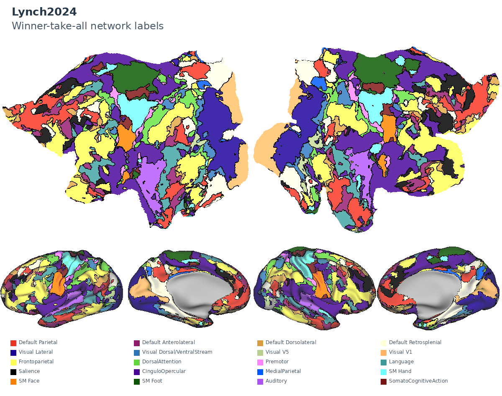

# pfm-mefmri

The goal of pfm-mefmri is **precision functional mapping (PFM)**: describing
functional areas and networks in individual human brains. The pipeline brings
resting-state and task fMRI through processing, denoising, and quality assessment
to support those individual-level descriptions, from a single visit to densely
sampled longitudinal studies.

It supports multi-echo and single-echo data, multiple distortion-correction
strategies, careful alignment to anatomy and within participants over time, and
quality assessment using motion, physiology, expert-calibrated FC quality scores
(Lynch et al., 2026), and crawling-seed FC movies. Individualized TMS targeting
with [TANS](https://github.com/cjl2007/pfm-tans) is an optional downstream module.


## Precision Functional Mapping (PFM)

**RidgePFM** combines individual functional connectivity with canonical network
templates and spatial priors whose [influence you can weight and explore](docs/ridgepfm-parameters.md).
It is a work in progress. A conventional **Infomap** workflow is also supported
as an option.



**[Download the interactive network-map selector](https://raw.githubusercontent.com/cjl2007/pfm-mefmri/main/docs/ridgepfm-taxonomy-explorer.zip)**:
The animation cycles through each taxonomy’s WTA map and four representative
softmax maps, retaining the network borders and a shared Low–High scale. Network
names follow each taxonomy; selected examples are not exact equivalents.

In the downloadable viewer, choose **Lynch2024**, **Du2024**, **Hermosillo2024**, or **Kong2019**, then WTA
labels or any network’s full-data softmax map. Check **Areal parcellation** to
view parcels derived from that taxonomy’s network map and individual FC.
Parcel fills show the majority network identity or mean softmax support;
borders follow the selected taxonomy’s parcels. With the option off, network
borders remain visible on softmax maps. Low–High colors show relative network
support. Download and extract the ZIP, then open the HTML in a browser.

[Explore λ and spatial-prior effects, then view the trade-off charts](docs/ridgepfm-parameters.md) ·
[Mapping outputs](docs/pfm-outputs.md) · [Sampling across visits](docs/individual-longitudinal-studies.md).

## Data organization

[Expected inputs and example processed outputs](docs/data-organization.md) for a
participant with resting-state, Motor, and WorkingMemory scans across sessions
and runs, including the naming and metadata checked by `validate`.

## Get started

1. Install the [dependencies](SOFTWARE_DEPENDENCIES.txt).
2. [Configure your project](docs/configuration.md): copy the templates outside the repository and set software paths and acquisition rules.
3. [Import your data](docs/setup-and-inputs.md#importing-inputs), then run:

```bash
bash /path/to/pfm-mefmri/bin/mefmri_pipeline.sh \
  /data/MyStudy/SUB001 /data/MyStudy/config/mefmri.sh
```

[Quick start](docs/quick-start.md) · [Workflow stages](docs/pipeline-overview.md) ·
[Output locations](docs/output-map.md) · [All guides](docs/README.md).

## Explore the workflow

| Section | What you will find |
| --- | --- |
| [Data organization](docs/data-organization.md) | Expected inputs, validate checks, and example rest/Motor/WorkingMemory outputs. |
| [Processing and setup](docs/pipeline-overview.md) | Distortion correction, denoising, anatomy, longitudinal alignment, and CIFTI outputs. |
| [Within-subject longitudinal alignment](docs/longitudinal-alignment.md) | Full-sequence comparison followed by focused examples of alignment within the same participant across scans and sessions. |
| [Individual network maps](#precision-functional-mapping-pfm) | RidgePFM WTA and softmax views across network taxonomies; conventional Infomap is also supported. |
| [RidgePFM parameters](docs/ridgepfm-parameters.md) | Interactive ME01 maps followed by reliability–individuality trade-offs and practical guidance. |
| [Quality-control gallery](docs/output-gallery.md) | Motion and physiology, expert-calibrated FC quality scores, crawling-seed FC movies, alignment, and signal QC. |
| [Individualized TMS](docs/tans/README.md) | Basic workflow, coil-search movie, and optional TANS module setup. |

Research software. Review participant data quality and modeled outputs before use; participant-derived figures require permission before public distribution.
