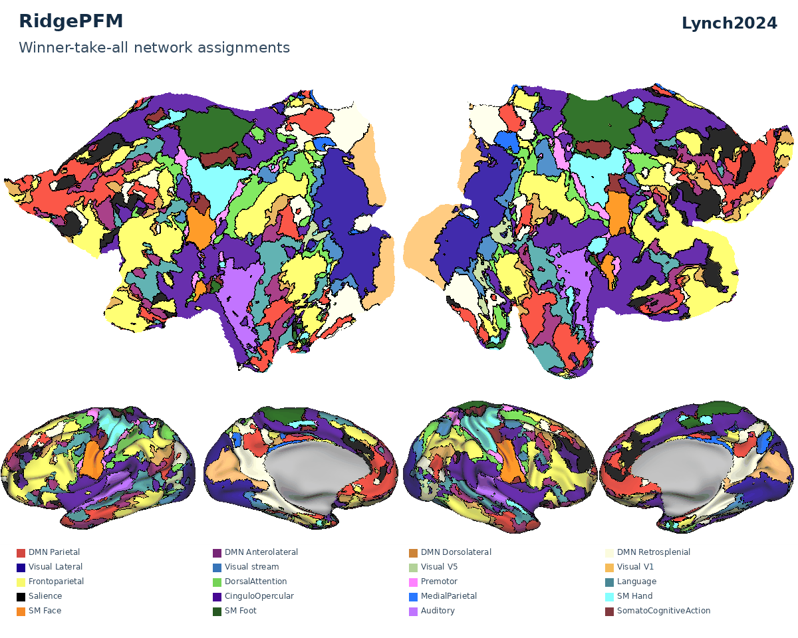
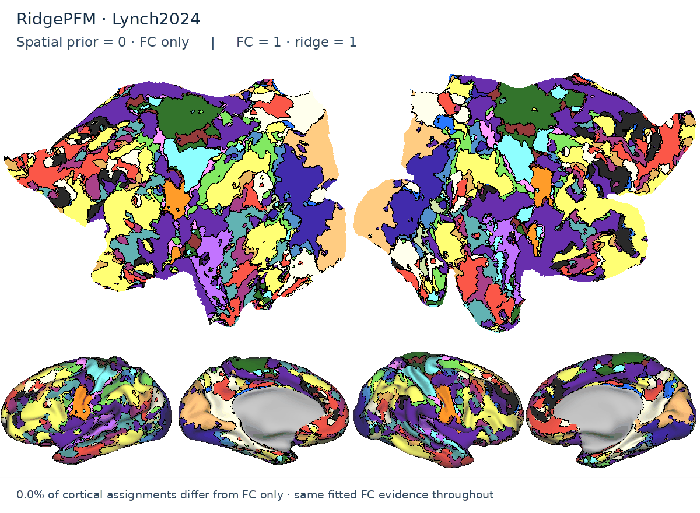

# pfm-mefmri

A pipeline for processing **individual resting-state and task fMRI data**, including
longitudinal data acquired across multiple sessions or visits. It integrates
multi-echo-specific tools and processing frameworks, with support for single-echo
acquisitions too.

Precision functional mapping (PFM) and individualized TMS targeting through
[TANS](https://github.com/cjl2007/pfm-tans) can be added at the end of processing.


## Precision Functional Mapping (PFM)

**RidgePFM is an approach we are developing** for fast, flexible mapping of
individual functional networks. It assigns locations within a chosen, established
functional taxonomy, combining individual FC with spatial priors whose influence
you can weight—from FC only to stronger group-prior guidance. Our goal is to
retain individual detail while making network labels easier to compare across
people and sessions. This is a work in progress that we think may offer a useful
alternative to Infomap in some settings; **Infomap remains supported** for users
who prefer it.

Choose **Lynch2024** (default), **Du2024**, **Hermosillo2024**, or **Kong2019**.
Defaults: **ridge = 1**, **FC = 1**, **spatial prior = 0.05**.



*ME01: each taxonomy cycles through WTA assignments, separate stripes for
reproducible FC with competing labels, and three network frequency maps from
10 independently mapped sessions. Frequencies describe session consistency;
model-fit maps are separate. Selected networks are illustrative, not exact
equivalents across taxonomies.*

<details>
<summary>Explore the spatial-prior weight: FC only → stronger group-prior influence</summary>



The same fitted FC evidence is used throughout; only the spatial weight changes.
This illustrates sensitivity to the prior, rather than selecting an optimal
weight. Ridge and FC weights remain 1.

</details>

[Mapping options, confidence states, and ribbon-constrained volume exports](docs/pfm-outputs.md).
Keep separate visit or epoch analyses when studying change.
[Repeat-sampling guidance](docs/individual-longitudinal-studies.md).

## Longitudinal and individual-level quality control

This pipeline was built for dense longitudinal studies. When the same person is
scanned repeatedly, consistent within-subject alignment over time is essential:
apparent functional change should not be driven by a changing registration.
The QC tools therefore connect network structure, runwise coregistration,
physiology, motion, and denoising in one review path.

**Crawling-seed FC maps** provide a quick visual review of network structure
across cortex. The ME01 example follows a seed continuously across the left
hemisphere and shows its whole-brain FC pattern on subject-specific surfaces.

[](docs/assets/qc-seed-fc-me01.mp4)

*ME01: as the seed moves across cortex, its functional-connectivity map updates.
[Watch the full movie](docs/assets/qc-seed-fc-me01.mp4); the looping preview samples
frames from the full cortical sweep.*

**Network Similarity Index (NSI)** quantifies how clearly an individual's
functional connectivity expresses large-scale network structure
([Lynch et al., 2026](https://www.cell.com/neuron/fulltext/S0896-6273%2826%2900412-5)).


*NSI-based estimate of PFM usability.*


*ME01 coregistration over time: the corrected SBRef from each of 44 scans is
shown against the same anatomical boundary, making drift or isolated failures
over time easy to see.*


*ME01 run-level review aligns respiratory and pulse traces with motion, FD,
DVARS, and signal changes through each denoising stage.*

[Full output gallery](docs/output-gallery.md) · [QC guide](docs/qc-modules.md).

Individualized TMS targeting is available as an optional final module through
[pfm-tans](https://github.com/cjl2007/pfm-tans). See the local
[TANS integration guides](docs/tans/README.md) for configuration and output details.

## Get started

1. Install the [dependencies](SOFTWARE_DEPENDENCIES.txt).
2. Adapt the [study configuration](config/mefmri_wrapper_config.sh) to your
   installation and acquisition.
3. [Import your data](docs/setup-and-inputs.md#importing-inputs), then run:

```bash
bash /path/to/pfm-mefmri/bin/mefmri_pipeline.sh \
  /data/MyStudy/SUB001 /data/MyStudy/config/mefmri.sh
```

[Quick start](docs/quick-start.md) · [Workflow stages](docs/pipeline-overview.md) ·
[Output locations](docs/output-map.md) · [All guides](docs/README.md).

Research software. Review participant data quality and modeled outputs before
use; participant-derived figures require permission before public distribution.
