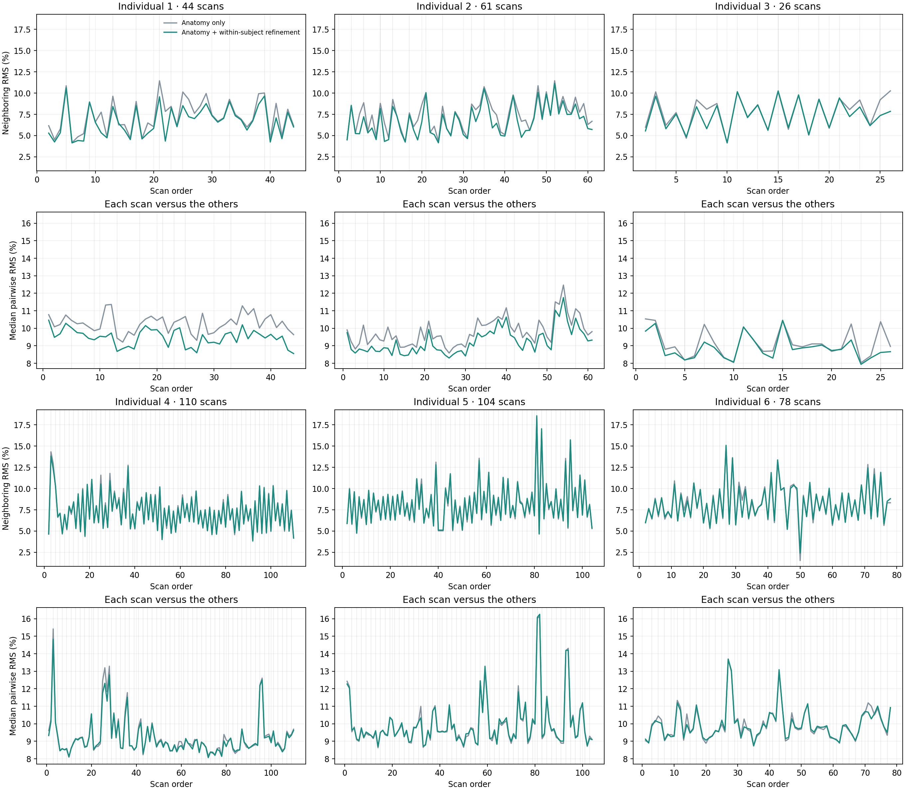
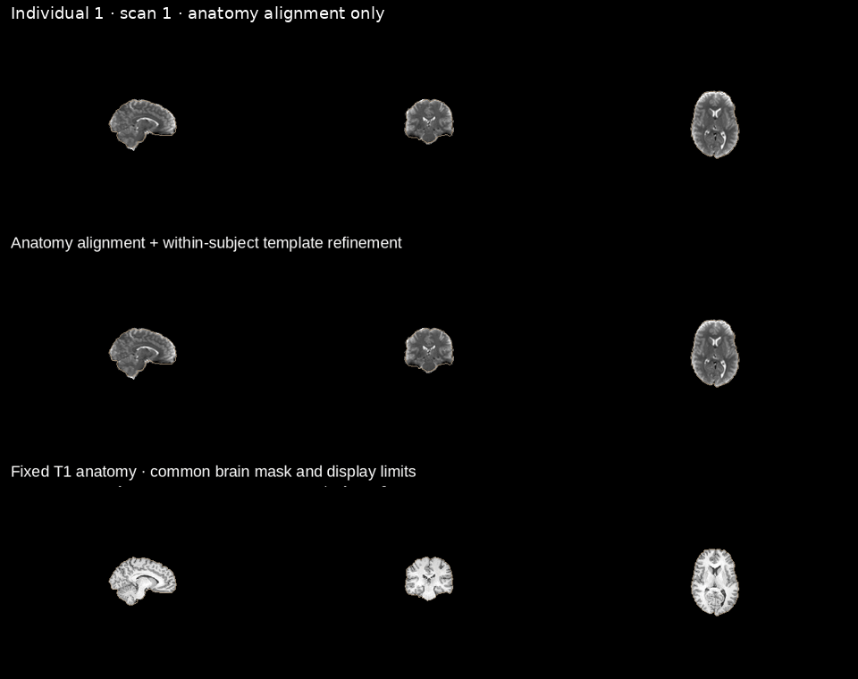
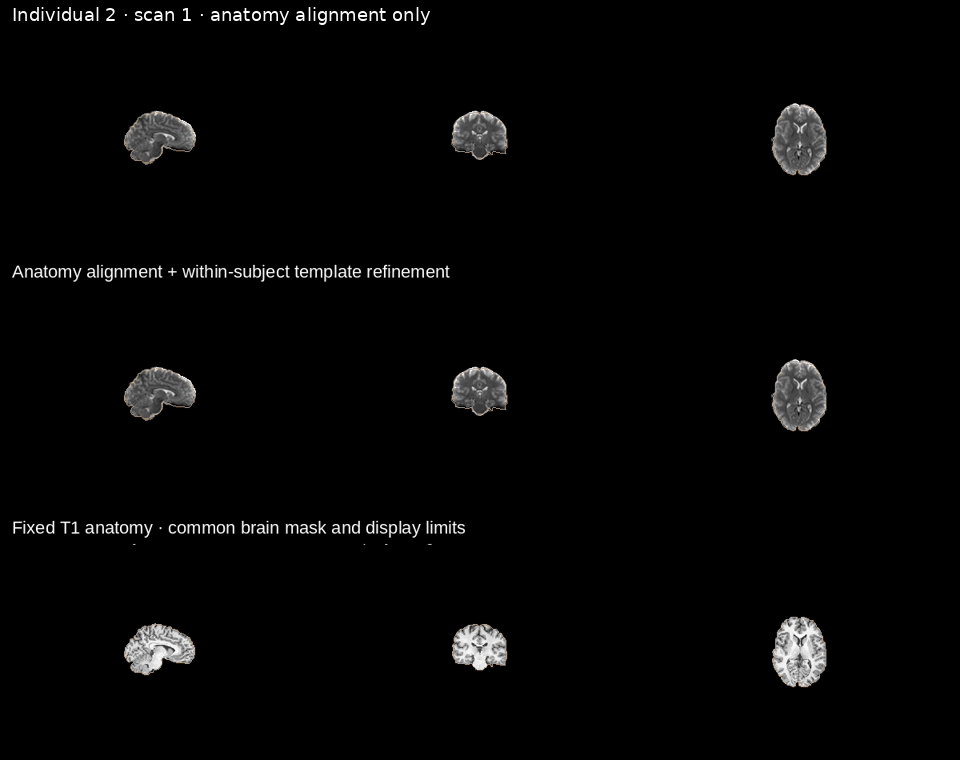
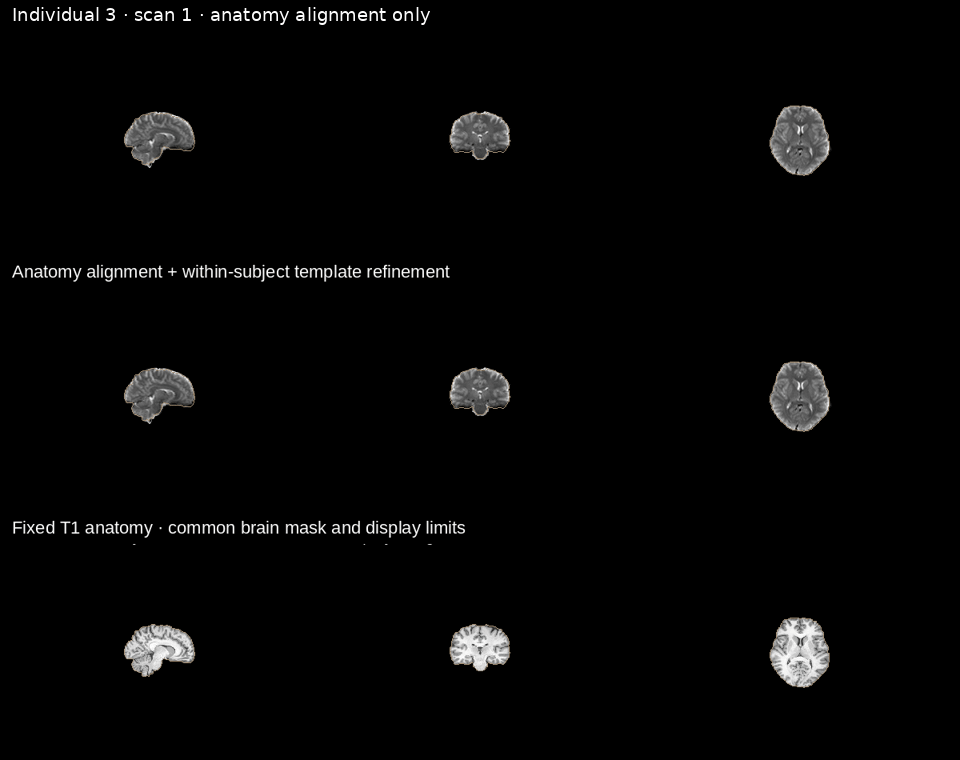
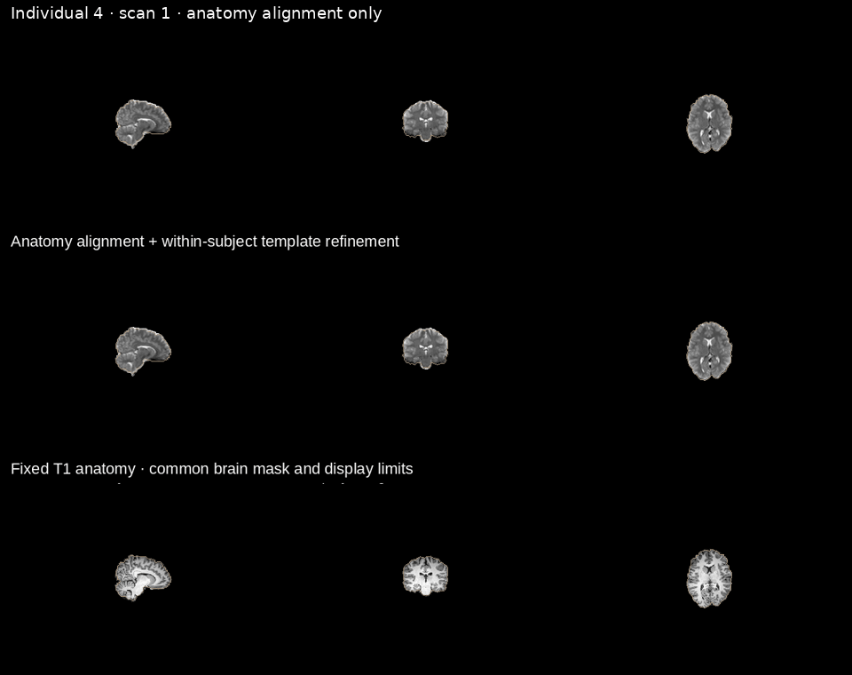
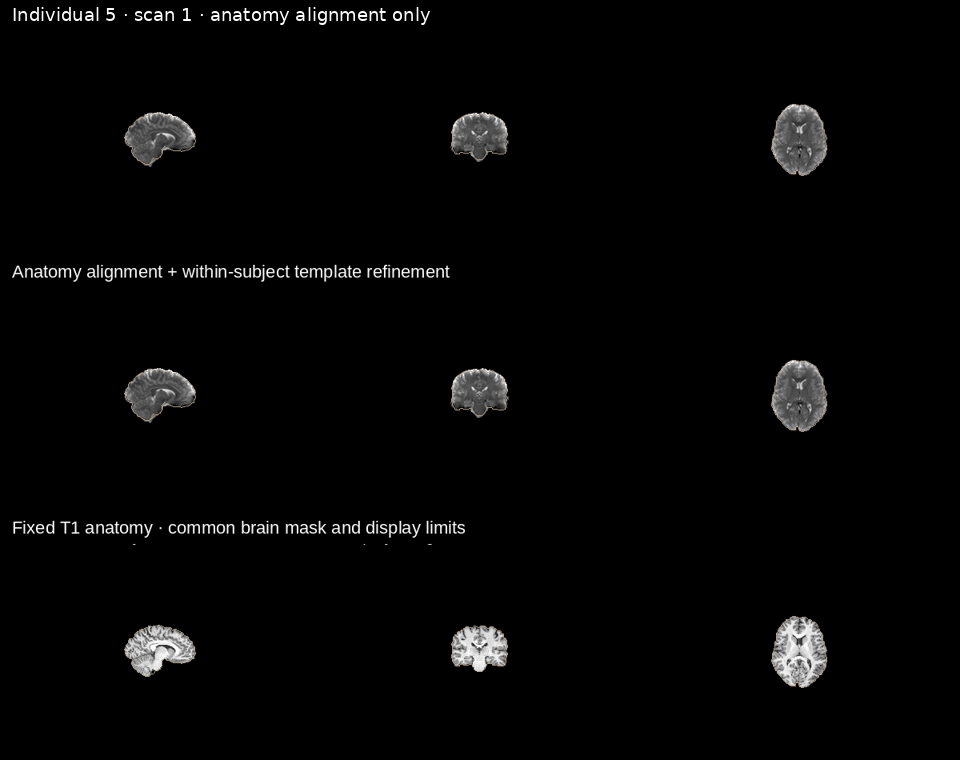
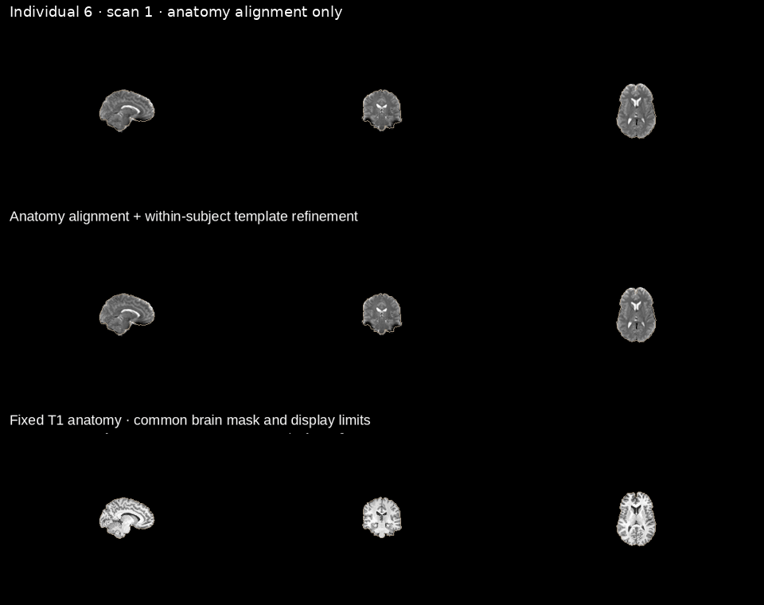

# Within-subject alignment: six-subject examples

These examples reproduce the saved two-iteration, session-balanced template-refinement demonstration, starting from native scan references and the original correction transforms. The regenerated baseline was checked against saved QA images before refinement. This does not validate every current production refinement option.

**Top row of each group:** difference from the preceding scan. **Bottom row:** each scan’s median pairwise difference to other scans, excluding itself. Thin lines mark session changes. Lower means more similar images. RMS reflects contrast and noise as well as registration; it is not displacement or proof of anatomical accuracy. These images also contributed to the refinement fit.

Identical anatomical masks, per-scan median-intensity normalization, and matched display limits are used before and after refinement. Runs lacking required saved transforms were excluded: 14 for Individual 4 and 16 for Individual 5. Comparisons concern the available acquisitions, not a complete acquisition census. Repeated scans are not independent participants.

## Individual 1

## Individual 2

## Individual 3

## Individual 4

## Individual 5

## Individual 6

[Numerical summaries](assets/coreg-stability/subject_summaries.csv) · [Figure PDF](assets/coreg-stability/six_subject_stability.pdf) · [Longitudinal alignment](longitudinal-alignment.md)
