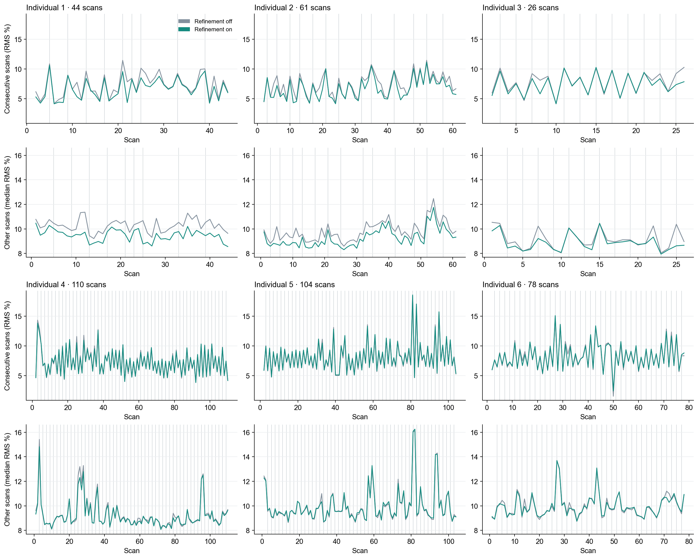
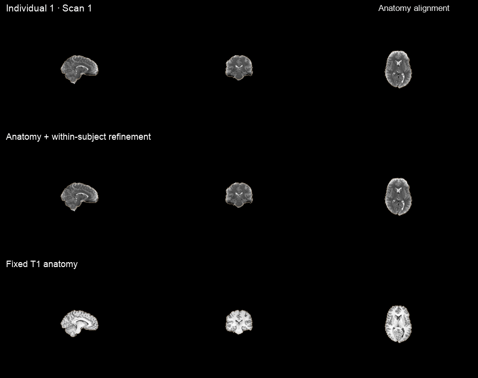
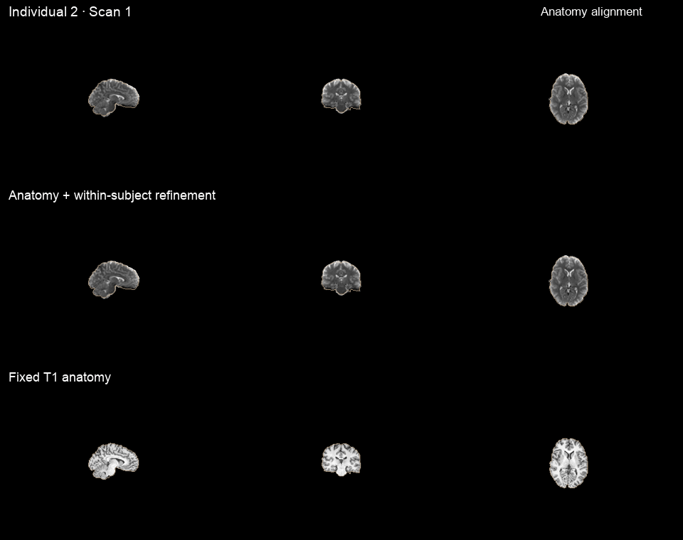
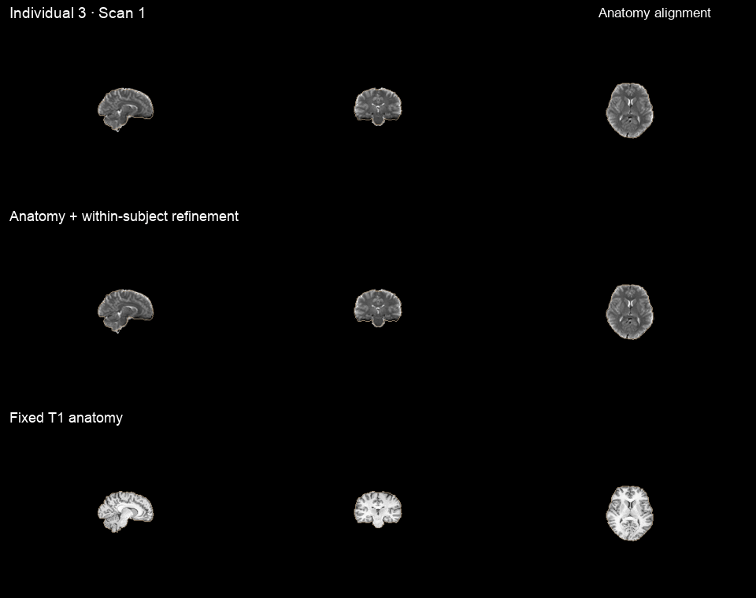
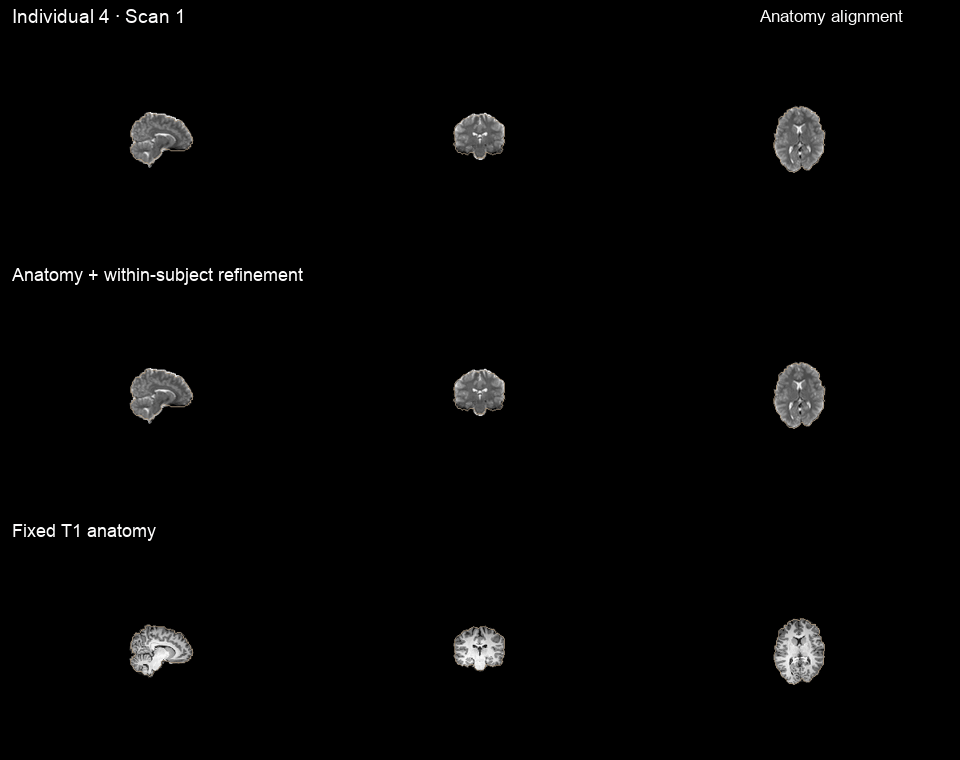
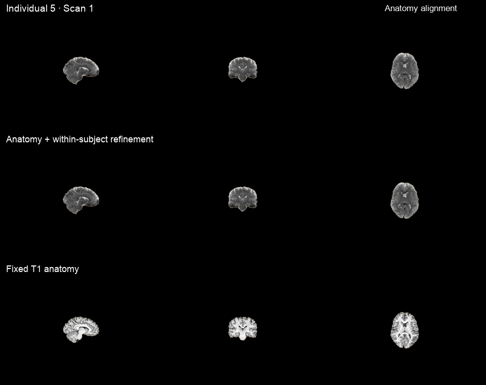
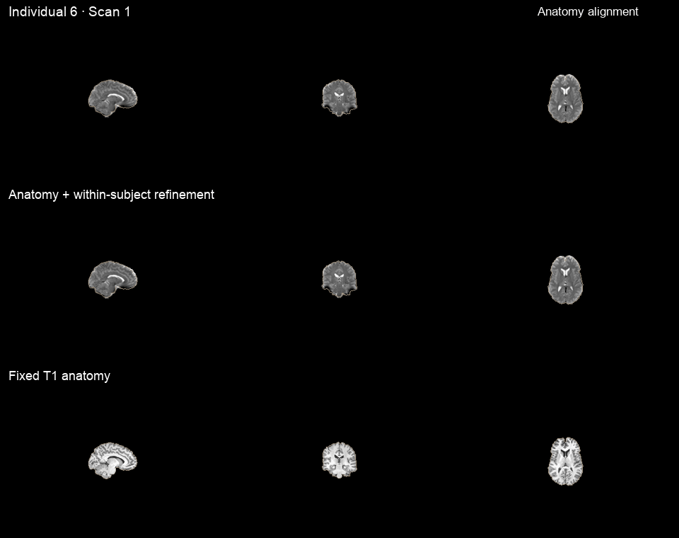

# Within-subject alignment examples

Six individuals illustrate how refinement affects consistency across acquisitions. Each movie compares anatomy alignment with anatomy plus within-subject refinement, using the same scans and display settings.

## Differences across scans

The upper row for each group shows differences between consecutive scans. The lower row shows each scan's median difference to the others. Vertical lines mark changes of session. Lower RMS means more similar images.

Measurements

The examples use saved two-iteration, session-balanced refinement. Baseline references were checked against the saved QA images. Comparisons use identical anatomical masks, per-scan median-intensity normalization, and matched display limits. RMS includes contrast and noise effects as well as alignment.

Runs missing the required saved transforms were excluded: 14 for Individual 4 and 16 for Individual 5.

## Individual 1

## Individual 2

## Individual 3

## Individual 4

## Individual 5

## Individual 6

[Numerical summaries](assets/coreg-stability/subject_summaries.csv) · [Figure PDF](assets/coreg-stability/six_subject_stability.pdf) · [Longitudinal alignment](longitudinal-alignment.md)
