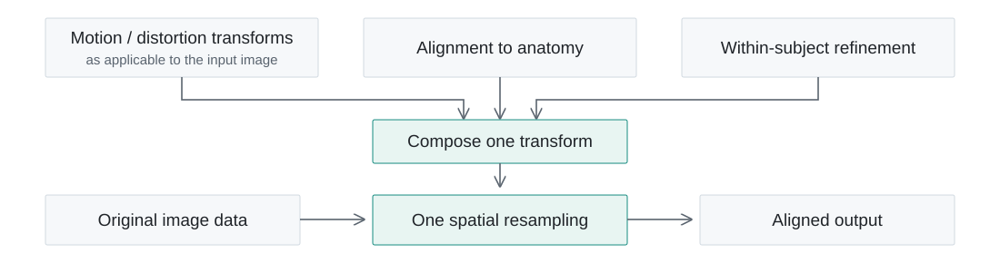

# Within-subject alignment

Each acquisition is aligned to the participant’s anatomy. Within-subject refinement improves consistency across that person’s runs and visits during functional processing, before motion correction and denoising.

## Configuration

```bash
COREG_ALIGNMENT_STRATEGY="subject_refined"
COREG_REFERENCE_POLICY="rebuild"
```

`independent` aligns each acquisition separately and remains the shipped configuration default. `subject_refined` adds within-subject refinement. `rebuild` estimates a reference using all available sessions; `frozen` uses a saved reference when adding sessions.

## One spatial resampling



The within-subject correction is composed with the existing transforms. The original images are resampled once with the combined transform.

## Review alignment

The [quality-control gallery](output-gallery.md#within-subject-alignment) shows fixed-anatomy movies, refinement comparisons, and scan-reference measurements.

RMS measures differences between scan references and depends on alignment, contrast, and noise. The normalized spatial gradient describes sharpness. Comparisons use fixed anatomical masks, image grids, and display limits.

[Processing workflow](pipeline-overview.md#within-subject-alignment)
