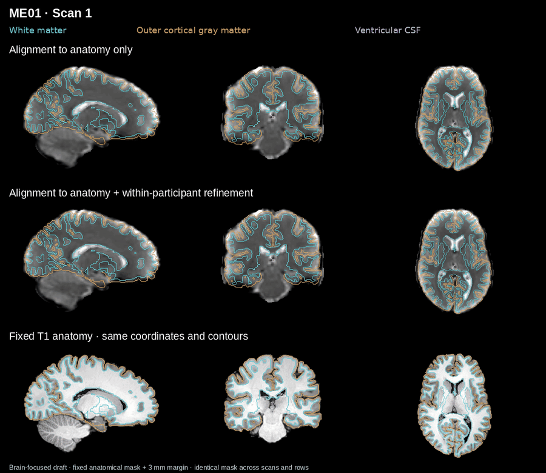
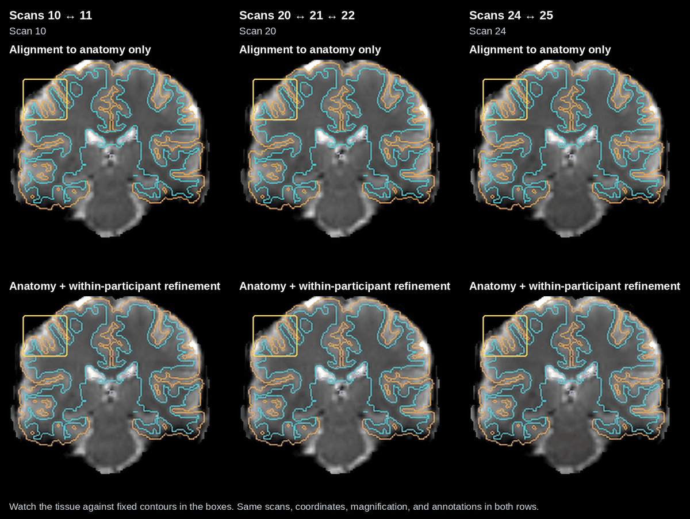
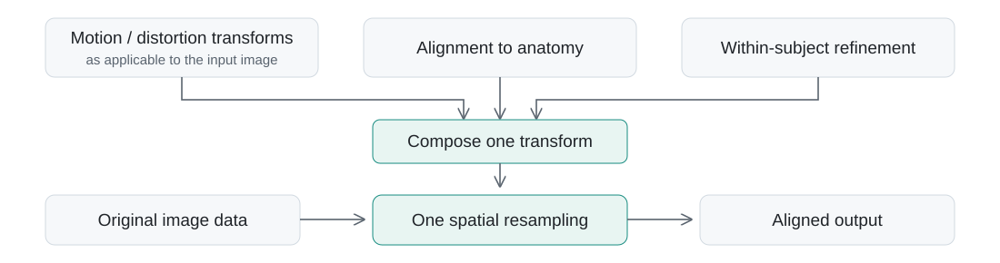
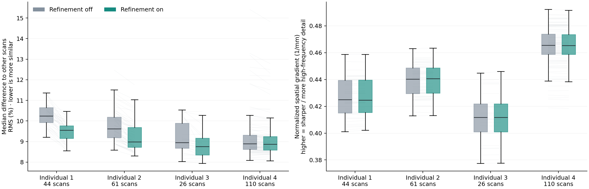

# Within-subject longitudinal alignment

Both approaches already provide good alignment to the participant’s anatomy.
The within-subject step is **fine-tuning**: it aims to dampen occasional small
placement shifts across acquisitions or sessions while retaining anatomical
alignment. The differences are often subtle, as the full sequence illustrates.

Careful alignment within the same person over time is a central design priority
of pfm-mefmri, supporting longitudinal studies of networks, behavior, and
within-person change. Individual 1 illustrates this with dozens of acquisitions.

## Full within-subject alignment video

The top row shows **alignment to anatomy only**. The middle row shows
**alignment to anatomy + within-participant refinement**: anatomy alignment is
retained, with added consistency across the participant’s acquisitions. Fixed T1
anatomy is shown below. Scans play in acquisition order; scan numbers help
navigate the sequence. Anatomical contours and slice coordinates remain fixed.
[Full-resolution video](assets/me01-coreg-before-after.mp4).

## Why within-subject alignment matters: focused transitions

Watch tissue placement against the fixed contours in the boxes. These selected
transitions make the placement shifts easier to see. Both rows use the same
scans, coordinates, magnification, and annotations; the full sequence above
provides context beyond these examples.

The selected transitions show concrete examples of the small placement blips
this refinement is intended to reduce. They highlight visible benefits; they
are not a quantitative estimate of the average improvement.

For clarity, these displays hide non-brain tissue using one fixed anatomical
brain mask with a 3 mm margin, shared across scans and both methods. This is a
display-only mask; registration and source images are unchanged.

## Refinement without an extra spatial interpolation

The within-subject correction is composed with the existing alignment transform.
The original image data are then spatially resampled once using the combined
transform; refinement does not repeatedly interpolate already aligned images.
Reference images used to estimate the transforms are separate from this final
application. This avoids an additional spatial interpolation, rather than
making resampling itself lossless.

## Quantitative scan-reference stability

**Left:** each scan’s median RMS difference to the other scans from that
individual; lower means more similar images. **Right:** normalized spatial
gradient, a measure of spatial texture; higher means sharper intensity changes.
Median paired changes in this sharpness measure range from **−0.014% to +0.045%**
across these individuals, consistent with no appreciable change on this measure.

Boxes show the middle 50% of scans and their median; whiskers extend to
observations within 1.5 times the interquartile range. Faint lines connect the
same scan with refinement off and on. Identical anatomical masks and image grids
are used in each comparison. Stability includes contrast and noise effects as
well as alignment; sharpness also depends on noise and contrast and is not an
estimate of effective resolution. These are descriptive checks on images used in
refinement, and scans are not independent participants.

Sharpness measurement

For each reference image, compute the mean squared forward intensity difference
along each spatial axis, divided by squared voxel spacing. Sum these three means,
divide by intensity variance within the same mask, and take the square root
(units: 1/mm). Adjacent voxel pairs must both lie within a fixed anatomical brain
mask eroded by two voxels. The normalization makes this measure invariant to a
global intensity scaling. A 1 mm Gaussian smoothing control reduced the measure
in all four individuals. This is a spatial-frequency diagnostic, not FWHM or a
direct measurement of retained biological information.

[QC gallery](output-gallery.md) · [Workflow overview](pipeline-overview.md) · [Back to README](../README.md)
