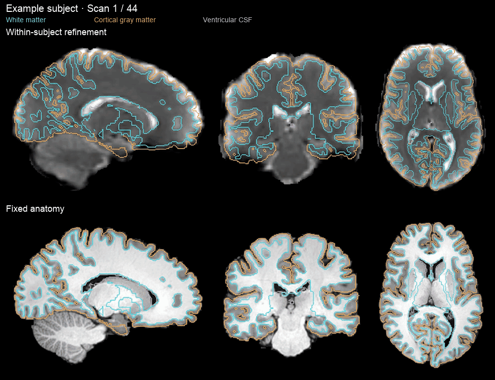
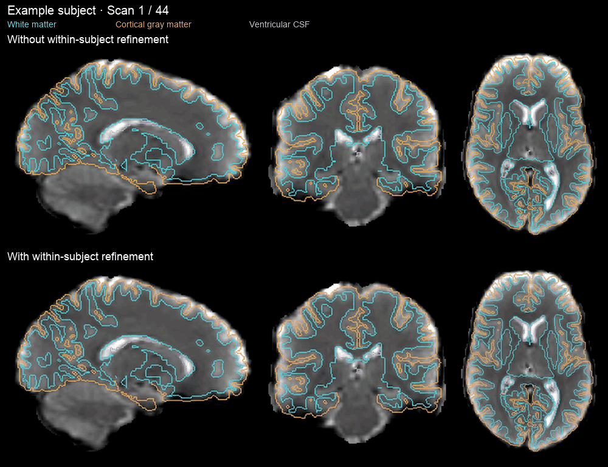
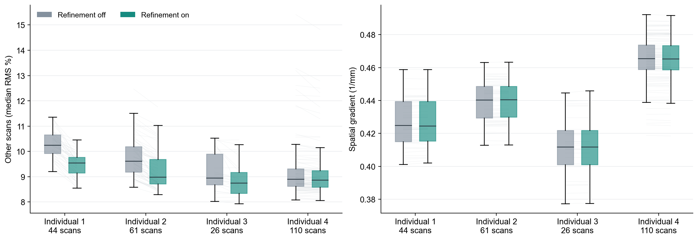
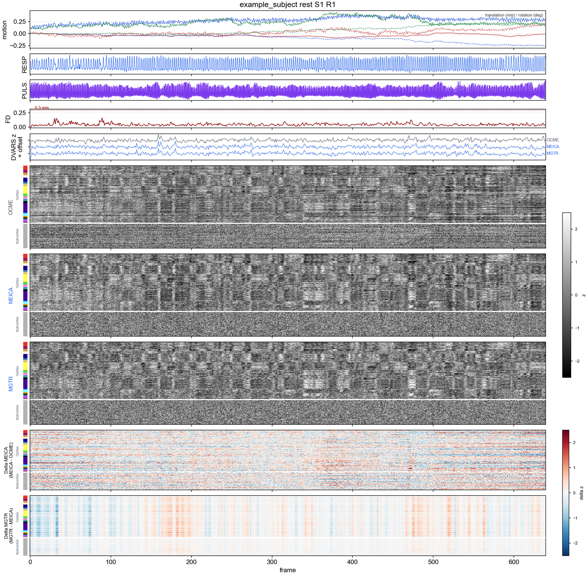
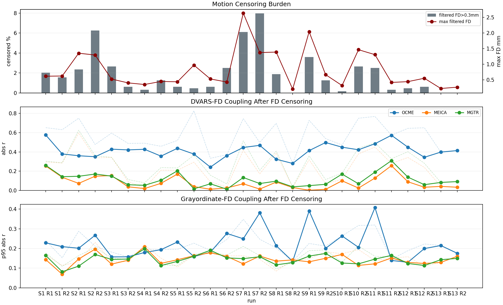
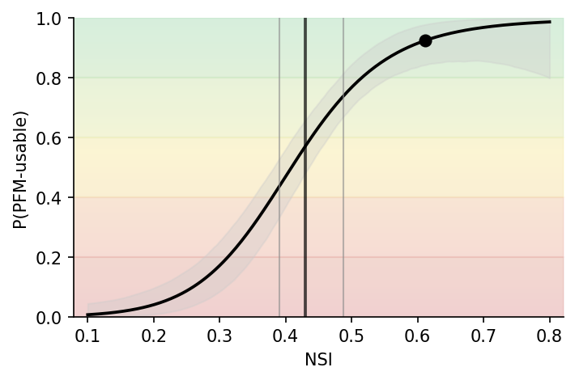
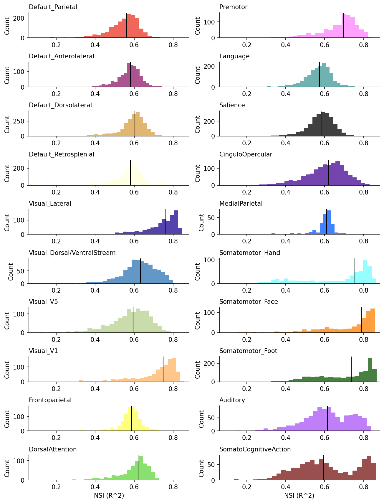
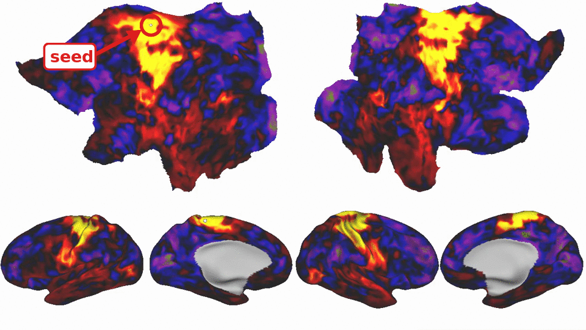

# Quality control

Examples of alignment, motion, physiology, FC quality, and seed-based connectivity from the pipeline's saved outputs.

## Within-subject alignment

Functional references across 44 acquisitions from one individual, with within-subject refinement. The anatomy and tissue contours stay fixed.

### Effect of refinement

The same scans without refinement (top) and with refinement (bottom). Both use the same views, crop, and anatomical contours.

Refinement reduces differences between scans while preserving spatial sharpness. Lines connect the same scan; boxes show the median and middle 50%.

[Processing and configuration](longitudinal-alignment.md) · [More alignment examples](coreg-stability-examples.md)

## Motion and physiology

Motion, respiratory and pulse traces, FD, DVARS, and grayplots through denoising and MGTR. Cortex and subcortex are separated by a thin divider and grouped by network within each block. The colored strips identify networks; this example’s cortical-only export leaves the subcortical strip gray.

The summary compares censoring burden and signal-motion coupling across runs and processing stages. Dashed traces show coupling before censoring.

## FC quality

Expert-calibrated FC quality scores estimate PFM usability (Lynch et al., 2026), using the NSI module.

Network-wise distributions show variation that a whole-brain average can hide.

## Seed-based FC

The small white marker identifies the seed; surface colors show its FC map. The animation samples the full cortical sweep.

[Full-resolution movie](assets/qc-seed-fc-me01.mp4) · [Still image](assets/qc-seed-fc-me01.png)

Example data and files

The motion example uses Individual 1, session 1, run 1, with 1,200 sampled grayordinates and physiological channels aligned to acquisition ticks. The 0.3 mm FD line reflects that example's configuration. The coupling summary uses 26 runs.

The seed-FC example uses subject-specific surfaces and the concatenated resting-state input used for the network-map example, with 1.7 mm Gaussian σ smoothing. The GIF samples one frame per second from a 70.2-second movie and plays at four frames per second. A brief opening callout identifies the seed.

Alignment and distortion-correction reportlets are saved under `QC/Coreg/` and `QC/Fieldmaps/`. Dataset-level seed-FC movies are saved under `QC/CrawlingSeedFC/`.

[Asset fingerprints](assets/manifest.json).

