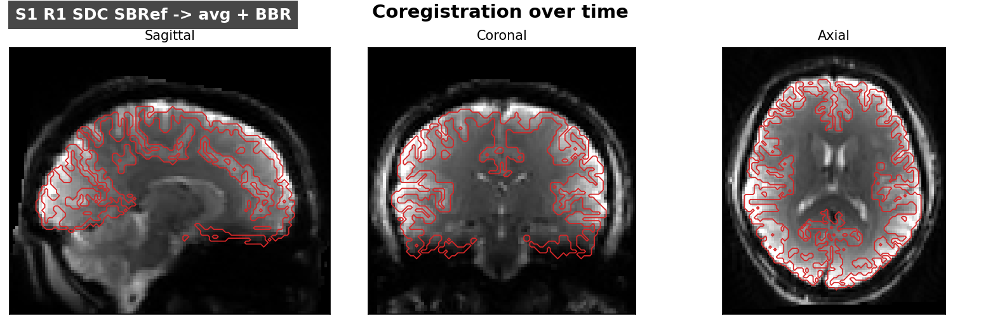
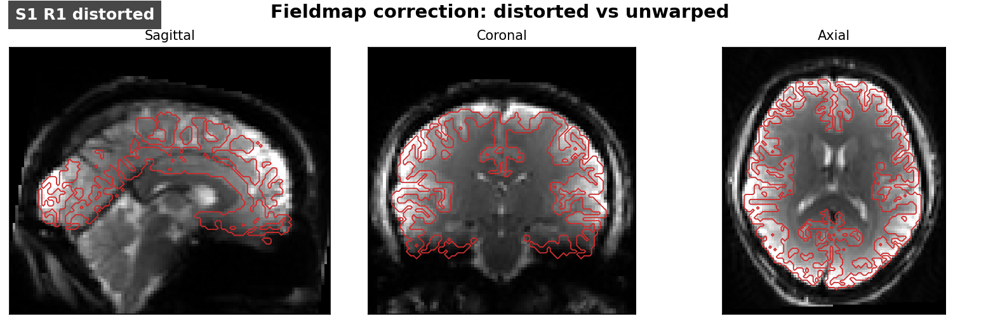
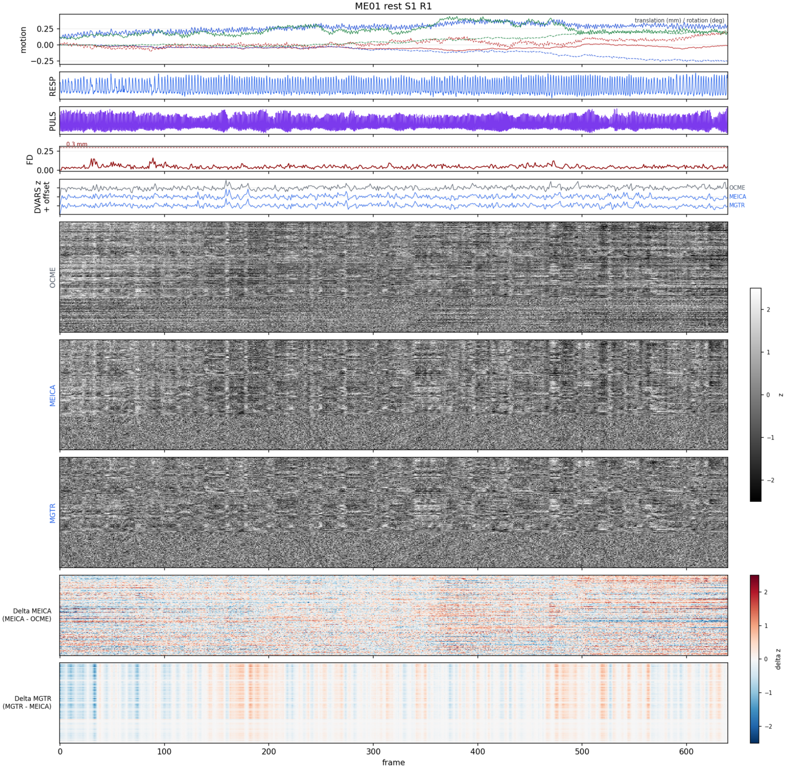
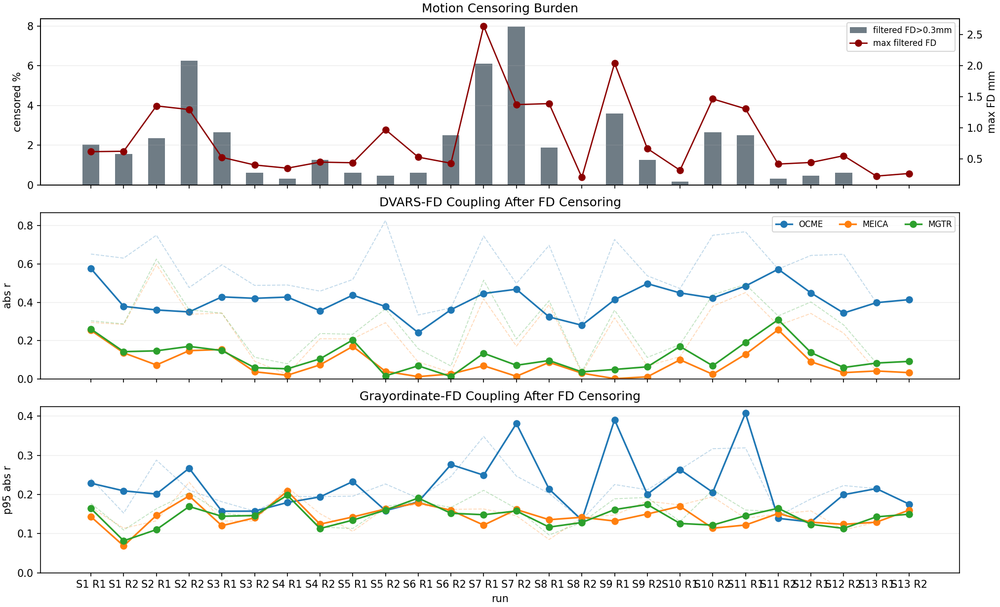
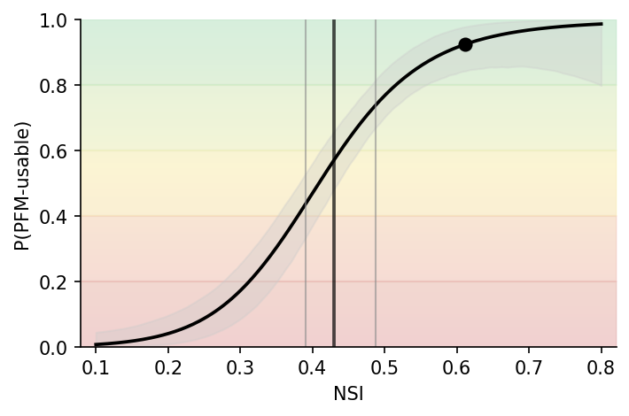
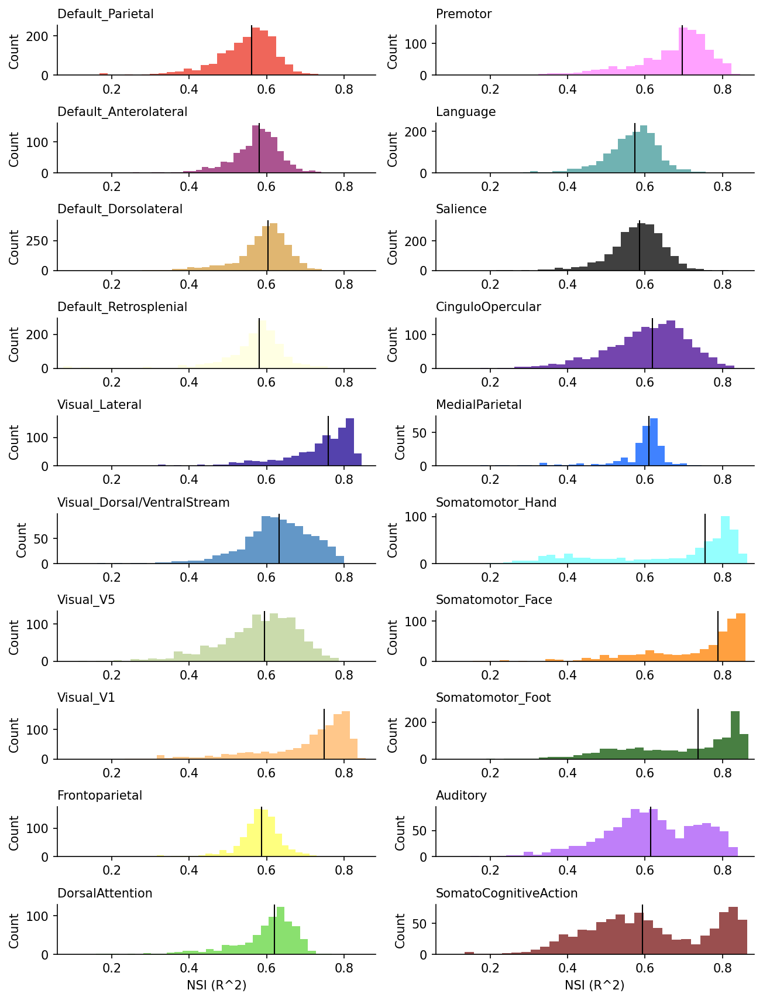
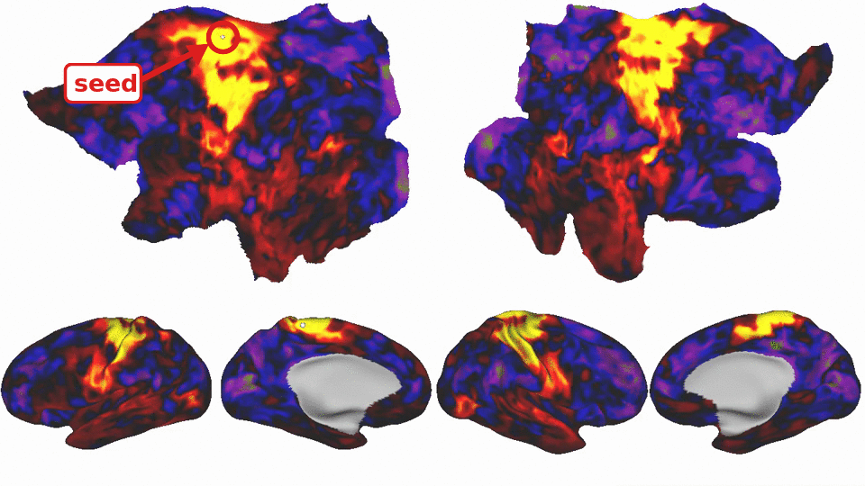

# Quality-control gallery

Examples of alignment, motion and physiology, expert-calibrated FC quality scores, and crawling-seed FC for
reviewing processed individual data. Individual 1 supplies the longitudinal and run-level
examples; older summary reportlets retain their original densely sampled examples.

## Alignment and fieldmap/SDC review

[Focused transitions and the complete longitudinal alignment comparison](longitudinal-alignment.md)
show saved independent alignment and within-subject template refinement.

These are production reportlets from `QC/Coreg/` and `QC/Fieldmaps/`. Review the complete HTML reports and metrics, including regions with weak signal
or potential susceptibility-related dropout.

## Signal quality and network signal

The motion figure shows **Individual 1 session 1, run 1**. It uses saved processing-stage
CIFTIs, the production QC plotting code, and 1,200 sampled grayordinates. The
respiratory and pulse channels are aligned to scanner acquisition ticks and
shown at their native temporal detail. No denoising is rerun. Its 0.3 mm FD line
reflects the example configuration, not a recommended universal threshold.

This unchanged production reportlet summarizes all 26 runs. The lower panels
compare absolute signal-motion correlations through processing stages after FD
censoring; faint dashed traces show the corresponding values before censoring.
Lower coupling alone does not establish that every source of artifact is removed.

The curve shows model-estimated PFM usability from expert-calibrated FC quality
scores (Lynch et al., 2026; implemented by the NSI module). It is not a
direct test–retest measurement, and its operating characteristics should not be
assumed to transfer to every acquisition or population. Network-wise summaries
help reveal heterogeneous quality that a whole-brain average can hide.

## Seed-FC review

[Full Individual 1 seed-FC movie](assets/qc-seed-fc-me01.mp4). The looping GIF samples one
frame per second from the 70.2-second movie and plays at four frames per second,
covering the full sweep after a three-second opening callout identifies the
small white seed. The MP4 retains all frames and has no added callout. The
[still image](assets/qc-seed-fc-me01.png) is decoded at 12 seconds. The
movie uses Individual 1 subject-specific surfaces and the concatenated, 1.7 mm-smoothed
resting-state input used for the RidgePFM example.
The movie and scene are written to `QC/CrawlingSeedFC/` when enabled.

## Provenance and sharing

`assets/manifest.json` records bundled file fingerprints and rendering types.
Source data and local provenance remain separate from the documentation assets.
Participant-derived figures require sharing review before public distribution.
