# Output gallery

The README's RidgePFM, crawling-seed FC, coregistration-over-time, and run-level
signal examples come from **ME01**. Older summary reportlets retain their
original densely sampled examples. The TANS illustrations retain a separate SAL
example and do not represent stimulation planning for the QC participants.

This gallery follows the participant from data-quality review to individual
mapping and optional stimulation planning. It contains selected examples, not
automatic pass/fail decisions, treatment recommendations, or a benchmark of
clinical performance.

## Alignment and fieldmap/SDC review

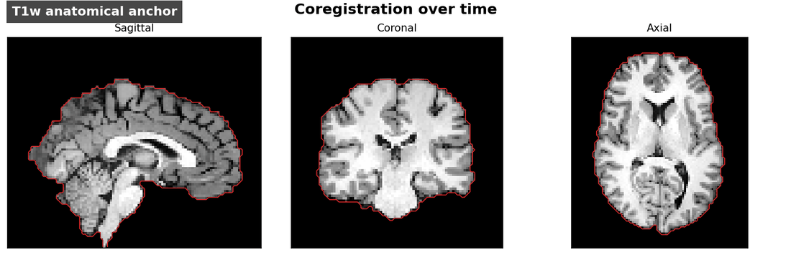

The animation cycles through the ME01 T1w anchor and all 44 saved corrected SBRef
volumes in chronological scan order. Each panel uses the same anatomical
boundary so drift or isolated failures are visible. No registration is rerun.

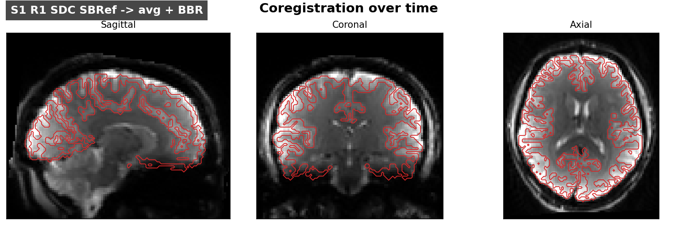

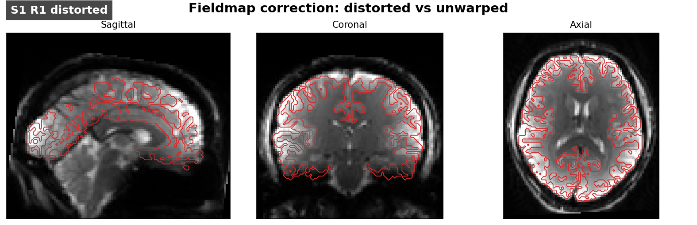

These are production reportlets from `QC/Coreg/` and `QC/Fieldmaps/`. The
animated panel shows the correction comparison, not an electric-field simulation.
Review the complete HTML reports and metrics, including regions with weak signal
or potential susceptibility-related dropout.

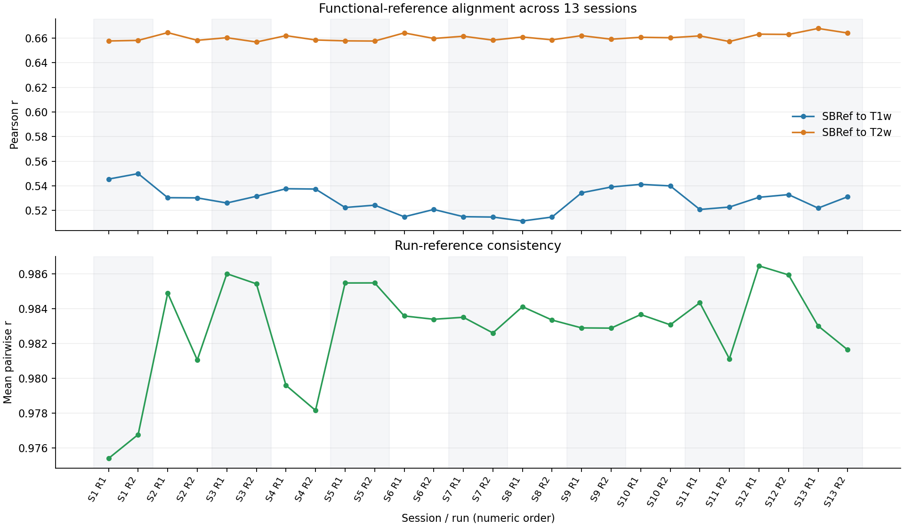

The alignment summary includes **all 26 runs across 13 sessions**. It replots
the saved metric values in numeric session/run order; the original report used
lexicographic folder order. No registration or similarity estimation was rerun.
Repeated-session alignment QC does not measure longitudinal network change or
an intervention effect.

## Signal quality and network signal

The motion figure shows **ME01 session 1, run 1**. It uses saved processing-stage
CIFTIs, the production QC plotting code, and 1,200 sampled grayordinates. The
respiratory and pulse channels are aligned to scanner acquisition ticks and
shown at their native temporal detail. No denoising is rerun. Its 0.3 mm FD line
reflects the example configuration, not a recommended universal threshold.

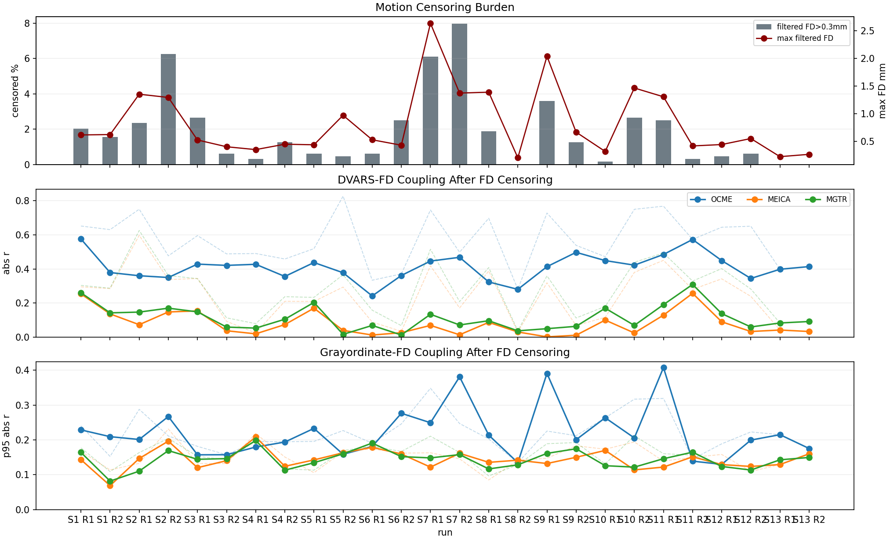

This unchanged production reportlet summarizes all 26 runs. The lower panels
compare absolute signal-motion correlations through processing stages after FD
censoring; faint dashed traces show the corresponding values before censoring.
Lower coupling alone does not establish that every source of artifact is removed.

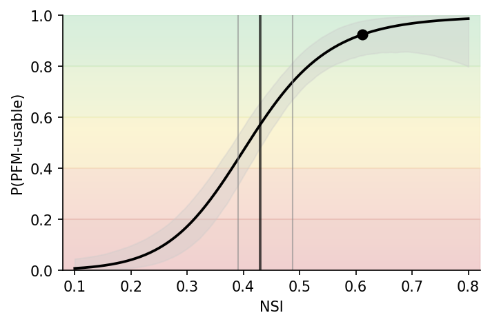

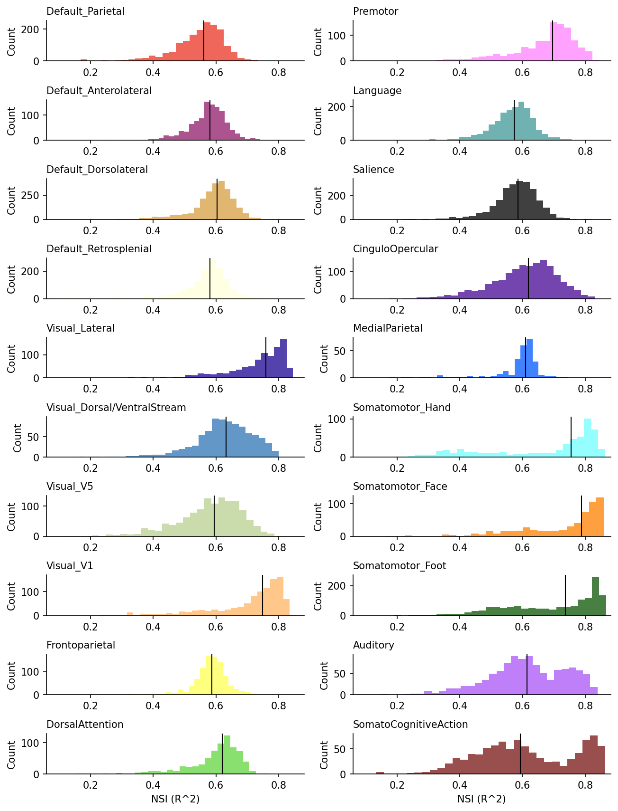

The curve estimates PFM usability using the selected NSI model. It is not a
direct test–retest measurement, and its operating characteristics should not be
assumed to transfer to every acquisition or population. Network-wise summaries
help reveal heterogeneous quality that a whole-brain average can hide.

## Seed-FC review

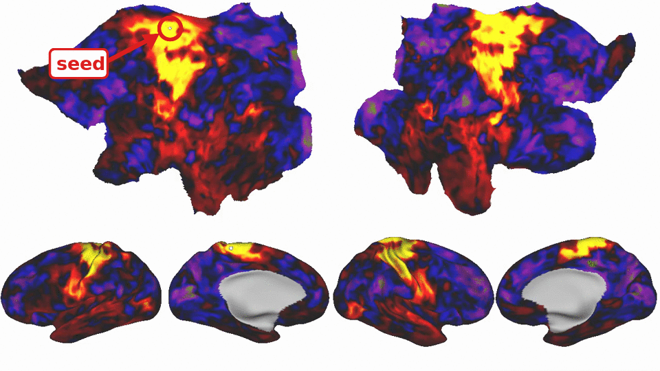

[Full ME01 seed-FC movie](assets/qc-seed-fc-me01.mp4). The looping GIF samples one
frame per second from the 70.2-second movie and plays at four frames per second,
covering the full sweep after a three-second opening callout identifies the
small white seed. The MP4 retains all frames and has no added callout. The
[still image](assets/qc-seed-fc-me01.png) is decoded at 12 seconds. The
movie uses ME01 subject-specific surfaces and the concatenated, 1.7 mm-smoothed
resting-state input used for the RidgePFM example.
The movie and scene are written to `QC/CrawlingSeedFC/` when enabled.

## Individual network representations

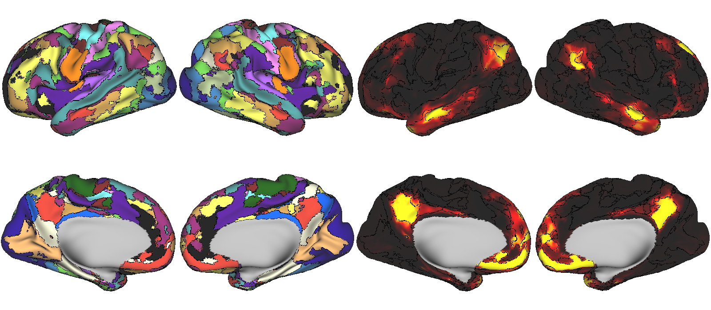

RidgePFM: all-network winner-take-all (WTA) maps on the left; the probabilistic /
weighted map for **DMN-Parietal** (`Default_Parietal`, the first network) on the
right. These documentation views are rendered with Connectome Workbench
from the saved CIFTIs and participant surfaces. The weight output is normalized
model evidence; it is not a calibrated posterior probability of true membership.

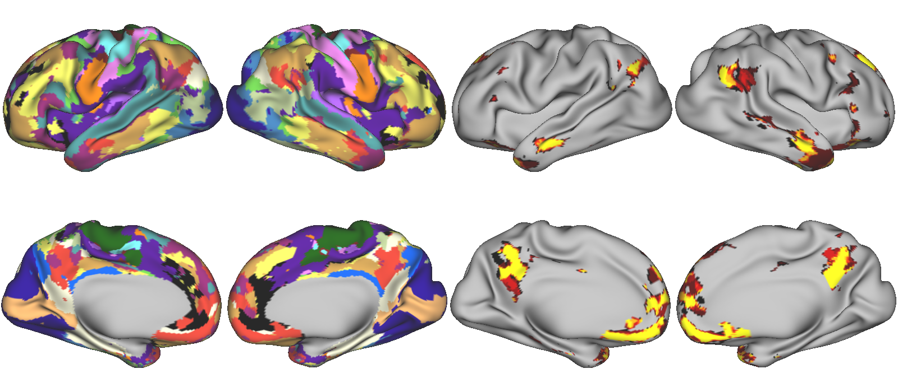

Infomap: mode-consensus labels on the left, first network's assignment frequency
on the right. Frequency is computed over densities with a valid assigned label
at that location; unassigned labels are excluded from the denominator. It is
not independent-run or longitudinal reliability. These panels use the same
participant as the QC examples but are not a formal accuracy comparison between
mapping methods. Surface boundaries in the RidgePFM view are its own saved
network borders; no RidgePFM borders are superimposed on the Infomap view.
Each continuous panel uses its stored display palette; color intensity is not
a common quantitative scale for comparing the two methods.

These are saved pooled-data maps, not separately estimated visit maps. The
RidgePFM display uses results generated under the earlier Ridge-Fusion name;
this documentation update does not recompute them with the new spatial weight
of 0.05. Figure provenance and filenames therefore retain the historical label. The
renderings show cortical views; the underlying CIFTIs can also contain
subcortical data. The existing Workbench review scenes and detailed
[PFM output guide](pfm-outputs.md) retain those broader review paths.

## Optional stimulation planning

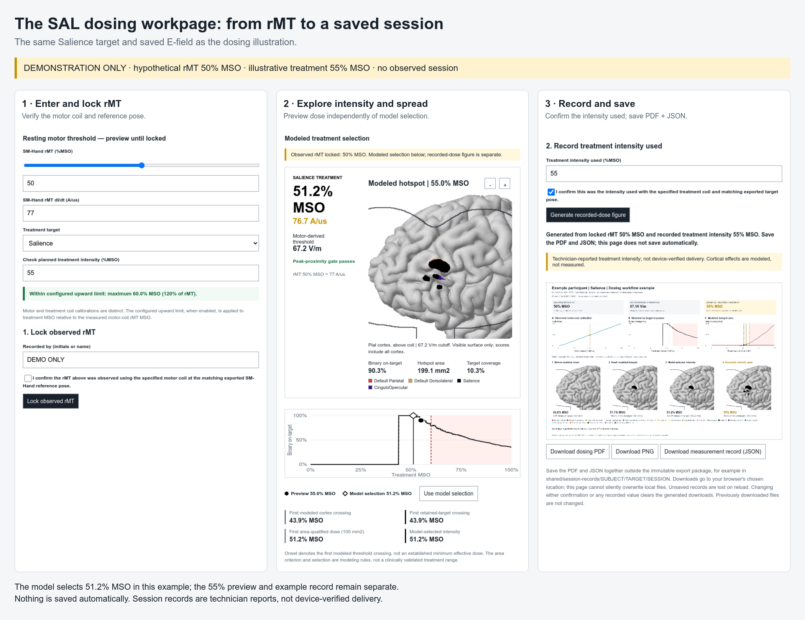

These reuse the reviewed SAL examples from pfm-tans. SAL/DLPFC is illustrative:
network identity and cortical search zone are separate choices. The optimization
layout has schematic history scores and an adjacent illustrated candidate rather
than the optimizer's winning placement. The dose-workpage illustration uses a
hypothetical 50% MSO rMT and 55% treatment MSO; the model's selection remains
distinct from the displayed/recorded example intensity.

These curated publication layouts are not guaranteed end-of-run figure layouts.
The actual software generates research reports, search replay outputs when
configured, and matched operator pages. See [TANS integration](tans-integration.md)
and the [pfm-tans gallery](https://github.com/cjl2007/pfm-tans).

## Provenance and sharing

`assets/manifest.json` records each bundled file's fingerprint and rendering
type. Restricted local provenance records retain the source paths. Raw MRI,
participant CIFTIs, head meshes, actual dose/session records, and operator export
packages are not included in this documentation gallery.

All participant-derived figures require maintainer permission review before
public distribution. Generic filenames/titles are not a guarantee of
anonymization. No model output shown here establishes clinical safety, treatment
response, or a universal neuronal activation threshold.
