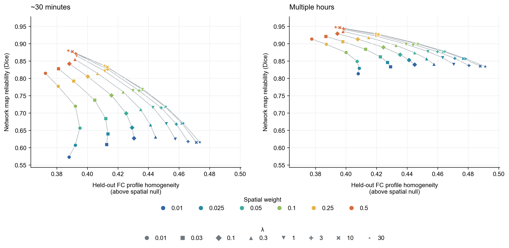
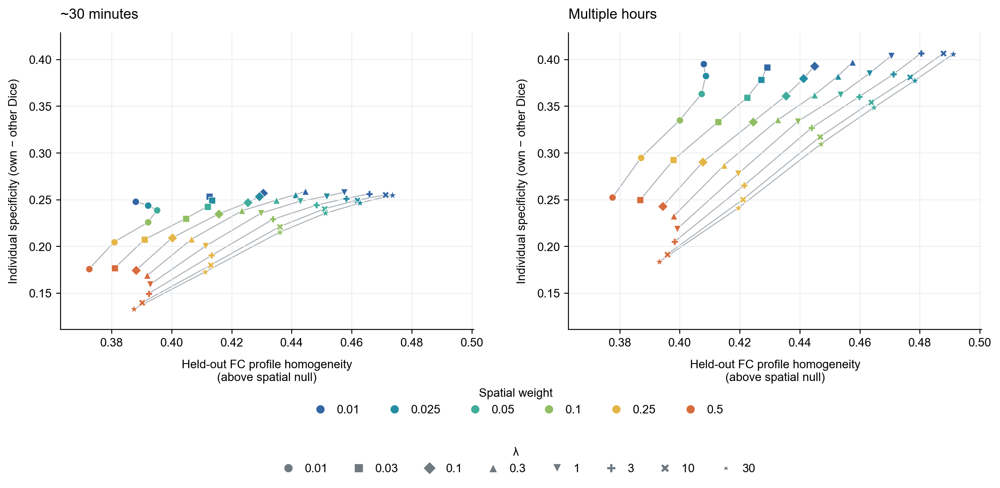
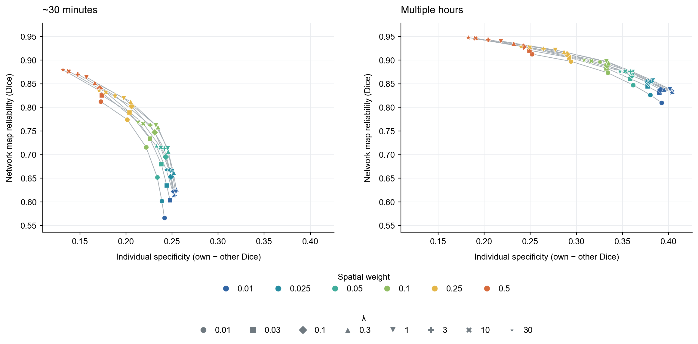
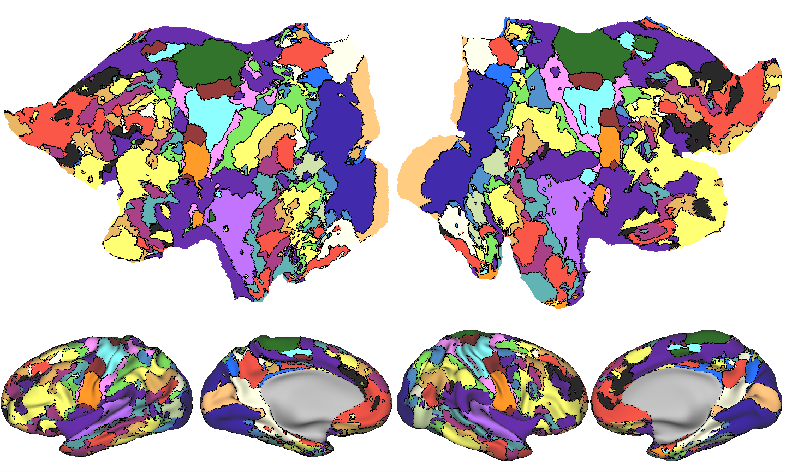

# Choose a reasonable RidgePFM setting with cross-validation

RidgePFM combines individual FC evidence with a population spatial prior. We want network labels that repeat across independent data while retaining individual-specific FC organization. These objectives can compete. Cross-validation makes that tradeoff measurable in each person and provides a practical way to select a compromise.



**Each point is one of the 48 λ × spatial-weight combinations.** Color encodes spatial weight consistently throughout: blue/teal = weaker prior; yellow/orange = stronger prior. Marker shape encodes λ, and gray lines connect the six spatial weights at a fixed λ. Both panels use identical axes. Some parameter settings overlap.

Moving right means more coherent held-out whole-brain FC profiles within the network map, above a spatial-null baseline. Moving up means more repeatable network labels across separate data. Increasing spatial influence can improve label agreement while sacrificing FC organization supported by the individual's held-out data. The tradeoff, rather than one universal parameter pair, is the result we want users to understand.

### Does the map retain individual-specific information?



A reproducible map can still be dominated by the group prior. Here, the vertical axis asks whether each person's map matches their own independent data more closely than it matches the other participants' maps. **Own-person Dice minus average other-person Dice** is computed at **identical λ and spatial weight** for every own/other comparison. A positive value indicates reproducible individual specificity; identical prior-only maps have zero advantage. Dice averages networks present in the reference map, with the same reference-network set used for its own-person and other-person comparisons. The colors and shapes have exactly the same meaning as above. This is evidence of stable person-specific structure; registration and stable nuisance can also contribute, so it is not anatomical ground truth.



This final view places reliability and individual specificity directly on the same plane. A useful map should retain both; maximizing agreement alone need not do so. All 48 combinations are shown and there are no hand-picked fixed comparator overlays.

*Figures use the N = 20 highly sampled cohort, averaging two session orientations within each person. The FC panels hold the same 19 complete-grid participants constant across every point and both data amounts: one participant had two cells with insufficient spatial-null support. The reliability–specificity figure uses all 20. FC summaries use saved independent evaluation with at least eight evaluable rotations per orientation/cell; available valid rotations can differ between cells. The original N = 20 CV-policy validation is unchanged. These are descriptive full-grid figures, not points representing six CV policies. The accompanying figure data record every λ/spatial pair and its outcomes.*

### From a tradeoff to a subject-level choice

CV turns this tradeoff into a reproducible decision rule. Retain a declared fraction of the best positive null-adjusted held-out FC profile homogeneity, then maximize network Dice among eligible settings. For example, **90% retention allows up to a 10% reduction** in the null-adjusted held-out FC profile homogeneity used for selection. That is an explicit preference, not a uniquely optimal biological threshold. The retained fraction is assessed during inner CV; independent test performance need not retain exactly that fraction.

The N = 20 experiment confirms that changing this preference produces an independently observed tradeoff. Compared with FC-only selection, the illustrative 90% policy increased opposite-session map Dice by about **10.5 percentage points for ~30-minute maps** and **5.0 points for maps from multiple hours**, while reducing null-adjusted held-out FC profile homogeneity. The full grid and the individual subject reports make alternative compromises inspectable rather than hiding them behind a single winner.

## Compact CV grid search

Specify a parameter pair as usual, or enable CV:

```bash
# Optional beta CV; fixed scalar parameters apply when disabled.
PFM_RF_CV_ENABLE=1
PFM_RF_CV_LAMBDAS="0.01,0.03,0.1,0.3,1,3,10,30"
PFM_RF_CV_SPATIAL_WEIGHTS="0.01,0.025,0.05,0.1,0.25,0.5"
PFM_RF_CV_MAX_FC_LOSS=0.10
PFM_RF_CV_MIN_PARTITION_MINUTES=10
PFM_RF_CV_MAX_COMPARISONS=10
PFM_RF_CV_N_ROTATIONS=100  # per A/B comparison; both directions share indices
```

1. **Divide data into A/B partitions.** Both sides contain guarded, complementary portions of the same runs; early/late contributions alternate across runs to reduce acquisition-time confounding. Additional comparisons use nonoverlapping data subsets when available. The requested count is a maximum, not a reason to reuse data or create very short partitions.
2. **Fit every λ × spatial combination on A and B.** Assess each A-trained map using B data and vice versa. Compare A/B labels with native-area-weighted Dice within each network, then average equally across the 20 networks.
3. **Measure held-out FC organization above a spatial null.** Spatially standardize each vertex's whole-brain FC profile. Average signed profile correlations between distinct members of each network. Weight network scores by their full vertex counts, and subtract the corresponding mean for rotated copies of the map. Real and rotated maps use their own actual network sizes on matched valid support. This is computed exactly without PCA/SVD or explicit all-pairs FC matrices.
4. **Choose the compromise and refit.** Average scores across comparisons. Among evaluable, non-dominated grid cells retaining the requested fraction of the maximum positive null-adjusted held-out FC profile homogeneity, choose the highest mean Dice. Break exact ties by null-adjusted held-out FC profile homogeneity and stable grid order. Refit the selected pair using all input data.

| Control | Meaning |
| --- | --- |
| `CV_LAMBDAS` | Positive ridge-penalty vector; λ = 30 is the current upper boundary, not a proved optimum. |
| `CV_SPATIAL_WEIGHTS` | Positive spatial-prior vector. The grid always excludes zero. |
| `CV_MAX_FC_LOSS` | Fractional loss of the best **positive advantage above null** allowed to improve reliability. 0 = FC-first; 0.10 = retain ≥90%. This is not a loss in raw BOLD correlation or a 10% change in every network. |
| `CV_MIN_PARTITION_MINUTES` | Minimum retained duration on each side. Actual durations are reported. More comparisons trade partition duration against repeated estimates. |
| `CV_MAX_COMPARISONS` | Maximum number of disjoint A/B comparisons supported by the data. Around 30 minutes often supports only one useful comparison. |
| `CV_N_ROTATIONS` | Number of fixed, shared spatial rotations; proposed production target 100. Rotations are spatial null maps, not extra independent participants or A/B comparisons. |

All names in the table use the `PFM_RF_` prefix. The complete proposed configuration also includes guard seconds, threads, rendering, and output directory. Current CV tunes one λ and one spatial weight across cortical parent networks; network-specific penalties are outside this module.

## What the report saves

The report shows the saved pair, full grid, FC–Dice frontier, the loss budget, actual partition durations, all-data surface previews, and per-network reliability. Controls let users explore another pair or budget without silently changing the saved output. Grid scores, frame assignments, provenance, A/B maps, full-data grid maps, and the selected all-data cortical map remain available. The workflow passes the selected scalar pair to the ordinary RidgePFM mapper for standard downstream outputs, then verifies that its cortical labels match the winning all-data grid column exactly.

Atlas departures are **descriptive checks**, not an optimization objective. More departures are not automatically better, and high reliability alone can reward a population-like map. Inspect individual FC coherence and the spatial pattern together. A CV-selected map should be compared using locked parameters in longitudinal work when the goal is to avoid parameter-reselection effects.

If no grid cell has positive null-adjusted held-out FC profile homogeneity or the partitions are too short, CV reports that it cannot select a supported pair; it does not silently substitute a zero score or a fixed winner. The interactive score is an estimate used for selection, not an untouched test of the winning map.

*Validation: 20 highly sampled participants; two held-out session orientations averaged within person. Independent evaluation used 32 spatial rotations (30–32 shared evaluable); the original selection pass used 16. CV for maps from multiple hours trained on 20–45-minute partitions before refitting hours-long pools, so this experiment does not establish what selection from hours-long training partitions would favor.  The new subject demonstrations use 100 rotations and fixed upstream preprocessing, so they provide conditional CV estimates rather than fully nested preprocessing or untouched external tests.*

## Example subject

Selected pair: **λ 30, spatial 0.1**. At a 10% FC-loss budget, this retains 91.0% of the best null-adjusted held-out FC profile homogeneity with 88.2% mean Dice.

[Download the interactive report](https://raw.githubusercontent.com/cjl2007/pfm-mefmri/main/docs/ridgepfm-cv-me01.zip).



<details><summary>Data and settings</summary>

44 runs, 628 retained minutes, TR 1.355 s. Input smoothing: 1.7 mm Gaussian σ (~4 mm FWHM), with no additional smoothing. Ten disjoint A/B comparisons use 25–33 minutes per side; the selected pair is refit on all data. The example exports cortical labels and scores FC profiles against whole-brain targets. Selection scores are conditional on the fixed preprocessing and are not an independent test of the final map.

</details>

## Practical settings and outputs

CV is initially supported for the **20 Lynch2024 cortical parent networks**, both cortical hemispheres, and signed FC. Other taxonomies and positive-FC-only mapping remain available in fixed mode. The ordinary mapper applies the selected scalar pair to the requested structures, including its normal downstream areal/uncertainty stages; the CV scores themselves evaluate cortical networks.

The initial split scheme requires **at least two eligible runs**. Each run is split at its acquisition-time midpoint with a guard on each side. Within each disjoint comparison, early/late polarity alternates across its contributing runs. Runs with too few retained frames in a guarded half are excluded and reported. With many runs, the planner tries up to the declared maximum count while preserving the minimum duration on each side and at least two runs per comparison. It does not count reused temporal samples as additional independent comparisons.

Additional controls:

```bash
PFM_RF_CV_GUARD_SECONDS=32
PFM_RF_CV_TR_SECONDS=""           # optional override; otherwise ScanInfo TR, then CIFTI header
PFM_RF_CV_THREADS=4
PFM_RF_CV_RENDER=1               # Workbench flat and inflated captures for every grid cell
PFM_RF_CV_KEEP_CACHE=0           # remove only private heavy cache after success
PFM_RF_CV_OUTDIR_NAME="CrossValidation"
PFM_RF_CV_ROTATIONS_CIFTI=""      # default: resources/RidgePFM_CV_Rotations.dtseries.nii
```

Spatial-null rotations use the same saved indices for all cells and directions. The current reference setting is100 rotations per temporal comparison, shared across the parameter grid and both directions. Thus10comparisons require2,000direction/rotation grid evaluations. This is configurable; map fitting itself is generally much cheaper than the full null scoring. A balanced total rotation budget is being evaluated separately and is not silently substituted here. Empty networks carry zero size weight for FC aggregation. A positive-weight singleton has no off-diagonal profile correlation and remains unevaluable. For each candidate within each temporal comparison, a rotation undefined in either direction is omitted from both directions; null-adjusted held-out FC profile homogeneity averages the remaining paired rotations. Comparisons retain equal weight. The report records the minimum valid-rotation count across comparisons. A candidate remains unsupported only if a comparison has no valid rotations or a required network Dice is undefined; missing scores are never replaced by zero. A prior-only control is displayed but never selected.

CV output is signature-bound to input/resource statistics, the numerical settings, and implementation files. When only the acceptable FC-loss budget changes, the workflow reuses a verified completed grid, selects the new pair and runs the ordinary mapper; it does not repeat grid fitting or spatial-null scoring. For CV runs, unchanged regression/smoothing inputs are reused after checking source, surface, software and output statistics, preserving the prepared-input identity. Each loss preference has its own run directory and provenance. Completed runs are reused only after saved output hashes match; interrupted runs retain partial checkpoints. The report and raw outputs are kept after private heavy cache cleanup. Input BOLD and geometry resources are never modified by CV.

```text
RidgePFM/
  RidgePFM_VTX.dlabel.nii                 # ordinary mapper, selected pair
  RidgePFM_VTX_Mapping.json               # actual pair + CV provenance
  CrossValidation/
    report.html                          # saved choice + what-if controls
    selected_parameters.json
    selected_refit_verification.json
    runs/<signature>/
      binding.json
      partitions.json                    # exact frame/run assignment for every pair
      grid_scores.csv
      network_scores.csv
      FullData_NetworkAssignments.dlabel.nii
      RidgePFM_CV_Selected_Cortex.dlabel.nii
      comparisons/p01/{A,B}_NetworkAssignments.dlabel.nii
```

For fast label mapping in examples with multiple hours, `PFM_RF_FIT_R2_MODE="skip"` uses the ordinary mapper's exact label path and writes NaN for the optional template-R² diagnostic. This does not change the CV objective. The separate legacy `PFM_HOMOGENEITY_TEST_ENABLE` diagnostic uses a different statistic and can be disabled when reviewing the CV report; CV does not invoke PCA/SVD.

For longitudinal comparisons, consider calibrating once and locking the selected scalars across later fits. Re-running CV in each dataset also introduces parameter-selection variability. The report records the tradeoff preference so that this choice remains reproducible.
