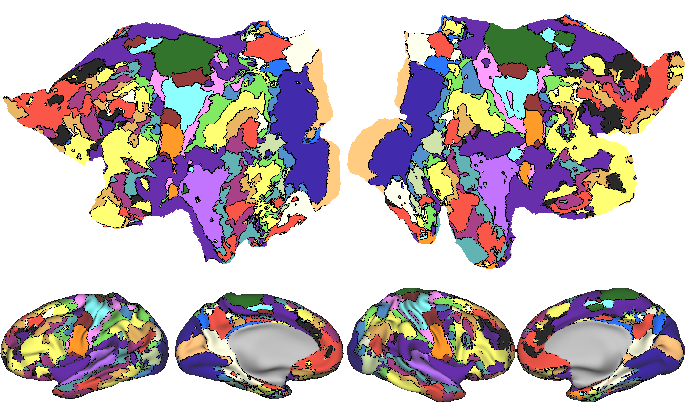

# Select parameters within each subject

Cross-validation measures the tradeoff in the person's own data, rather than choosing parameters from cohort averages alone.

1. Fit each λ × spatial-weight pair on complementary A/B blocks drawn from multiple runs.
2. Using training-defined labels, evaluate FC profile homogeneity in the opposite partition relative to rotated copies of the map. Measure A/B network map reliability with Dice.
3. Select the most repeatable pair within an allowed loss of null-adjusted homogeneity, then refit using all data.

**Held-out FC profile homogeneity** measures the generalization of the fitted network organization. Whole-brain FC profiles are spatially standardized, their correlations averaged within each training-defined network, and network scores weighted by vertex counts. The spatial null is the mean score for rotated copies of the training map on the cortical sphere.

## Example subject

Ten A/B comparisons selected **λ 30, spatial weight 0.1**, retaining **91.0%** of the best null-adjusted held-out homogeneity with **88.2% mean Dice**. The selected pair was then refit on all available data.

[](https://raw.githubusercontent.com/cjl2007/pfm-mefmri/main/docs/ridgepfm-cv-me01.zip)

[Download the example subject report](https://raw.githubusercontent.com/cjl2007/pfm-mefmri/main/docs/ridgepfm-cv-me01.zip). Extract the ZIP and open `report.html`.

## Enable CV

```bash
PFM_RF_CV_ENABLE=1
PFM_RF_CV_LAMBDAS="0.01,0.03,0.1,0.3,1,3,10,30"
PFM_RF_CV_SPATIAL_WEIGHTS="0.01,0.025,0.05,0.1,0.25,0.5"
PFM_RF_CV_MAX_FC_LOSS=0.10
PFM_RF_CV_MIN_PARTITION_MINUTES=10
PFM_RF_CV_MAX_COMPARISONS=10
PFM_RF_CV_N_ROTATIONS=100
```

A 10% loss budget retains at least 90% of the best positive, null-adjusted homogeneity score, then favors reliability of network maps. The report shows the full grid and alternative choices. 

Both sides of each comparison combine guarded early and late portions of different runs. Additional comparisons use nonoverlapping data, with the requested number acting as a maximum. Undefined rotations are omitted within each comparison. The current rotation count is per comparison.

Fixed parameters remain available with `PFM_RF_CV_ENABLE=0`.

<details>
<summary>Example data and outputs</summary>

The subject has 44 runs and 628 retained minutes, with TR 1.355 seconds and 1.7 mm Gaussian σ input smoothing (~4 mm FWHM). No additional smoothing is applied for CV. Each partition contains 25–33 minutes; the final map uses all retained data.

The report previews the first A/B comparison and the all-data maps. Scores average all ten comparisons. The example exports cortical labels, while FC profiles use all valid whole-brain targets. The CV scores select parameters and are not an independent evaluation of the final all-data map.

CV currently tunes one λ and one spatial weight across the 20 Lynch2024 parent networks. Grid scores, partition assignments, selected parameters, and maps are saved with the report.

</details>

[Spatial-prior tradeoffs](ridgepfm-spatial-priors.md) · [Starting ranges](ridgepfm-parameter-ranges.md)
