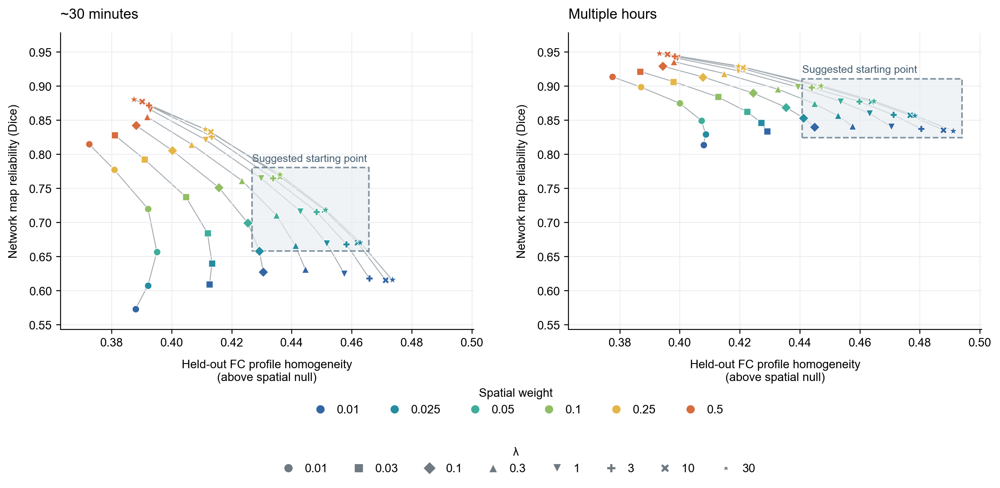

# Reasonable parameter ranges

The amount of data affects the reliability available at a given spatial weight. With about 30 minutes, a stronger prior can help stabilize labels. With multiple hours, weaker priors can retain more individual detail while still giving repeatable maps.

The boxes below mark illustrative starting points in the cohort. The highlighted settings provide general guidance on a suitable starting point.

| Retained data | λ | Spatial weight |
| --- | ---: | ---: |
| About 30 minutes | 1–30 | 0.025–0.1 |
| Multiple hours | 3–30 | 0.01–0.1 |

The highlighted settings retain at least 90% of the maximum positive, null-adjusted held-out homogeneity in each cohort panel. The multiple-hour region includes weaker priors because these maps remain more repeatable than short-data maps at comparable settings. The ranges overlap: data duration alone does not determine the best pair for a person.

Color shows spatial weight and shape shows λ. Boxes enclose the indicated grid settings; they are not uncertainty intervals. FC weight is held at 1.

[Inspect parameter effects in a subject](ridgepfm-spatial-priors.md) · [Select a pair using CV](ridgepfm-cv-selection.md)

Scope of this guidance

The FC panels use the same 19 complete-grid participants from a cohort of 20 highly sampled people. These are descriptive cohort averages at fixed settings. Acquisition quality, sampling, and the preferred balance of homogeneity and reliability also matter. The multiple-hour maps were refit from hours-long pools; CV calibration used shorter partitions. 

