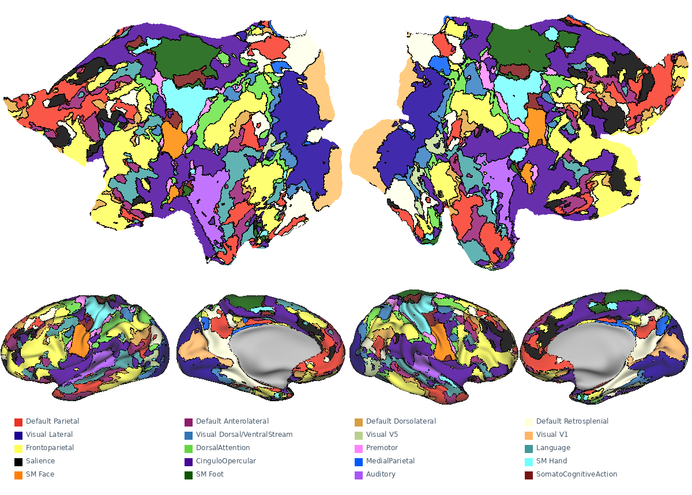
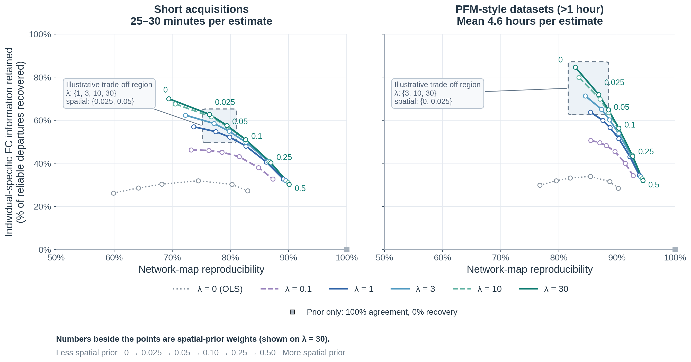

# RidgePFM parameters

These are general guidelines based on our data so far.

| Intended use | Ridge λ | FC weight | Spatial weight | Interpretation |
| --- | ---: | ---: | ---: | --- |
| Usual acquisition, approximately 30 retained minutes | 1 | 1 | 0.025–0.05 | 0.05 favors repeatable canonical labels; 0.025 allows more individual departures. |
| Multiple hours, or greater emphasis on individual topography | 10–30 | 1 | Around 0.025 | Recovers more reference-supported individual organization, with some loss of label agreement. |
| FC-only sensitivity check | 1–30 | 1 | 0 | Shows how much the prior constrains the map; expect a larger reliability cost. |

## Explore network-map parameters

[](ridgepfm-explorer.html?raw=1)

**[Download the interactive parameter explorer](ridgepfm-explorer.html?raw=1)**
and open it in a browser. These maps use ME01’s full **10.5 retained hours** and
the same surface layout as the [parcellation and softmax selector](ridgepfm-taxonomy-explorer.html?raw=1).
The spatial = 1 setting illustrates strong prior influence outside the N = 20
validation grid; the prior-only control discards individual FC entirely.

## RidgePFM parameter trade-offs

Maps should be **reproducible** while retaining **reliable individual-specific FC
information**—the goal of PFM.



Moving **right** means more reproducible network labels; moving **up** means
recovering more individual atlas departures that repeat independently, with the
same alternative network identity. Label agreement uses a held-out map with
matched parameters; departure recovery uses a shared, independent Pearson reference.

Each curve fixes λ; **numbers beside points are spatial-prior weights**. Stronger
priors generally improve agreement while suppressing individual variation. Shaded
boxes highlight reasonable trade-off regions. In dense data, λ = 3–30 with spatial
weight 0–0.025 offers a useful range to explore.

*Cortical results from 20 participants, averaging repeated samples within each
person first. Left: 25–30 minutes per map. Right: more than one hour, averaging
4.6 hours per map. FC weight = 1. [Figure PDF](assets/ridgepfm/ridgepfm_tradeoff.pdf) ·
[Analysis definitions](assets/ridgepfm/data/figure_methods.json).*

## What the parameters change

**λ** regularizes competition among FC templates; **spatial weight** controls the
influence of the population prior. Because FC coefficients are standardized,
higher λ can preserve more individual information rather than simply suppressing
FC. Very large λ approaches direct template matching; λ = 0 is multitemplate OLS.

## Full-data softmax maps

The [network-map selector](ridgepfm-taxonomy-explorer.html?raw=1) shows every
network with its parcellation’s WTA borders. Softmax expresses relative network
support. Low–High uses the same clipped display range (0.025–0.50) throughout;
the underlying values are unchanged.

<details>
<summary>Figure data and reproduction</summary>

The [participant summaries](assets/ridgepfm/data/participant_estimates.csv),
[analysis definitions](assets/ridgepfm/data/figure_methods.json), and
[duration summaries](assets/ridgepfm/data/dense_durations.csv) accompany the figure.
[Full 0–100% x-axis](assets/ridgepfm/ridgepfm_tradeoff_full_axis.pdf) ·
[Short-acquisition panel](assets/ridgepfm/ridgepfm_tradeoff_clinical.pdf).

Reproduce from the repository root with Python, NumPy, pandas, and Matplotlib:

```bash
python tools/plot_ridgepfm_tradeoffs.py --output-dir /tmp/ridgepfm-figures
```

This reads the frozen participant summaries and writes PNG, SVG, PDF, and a
render receipt without fitting new FC maps.

</details>
