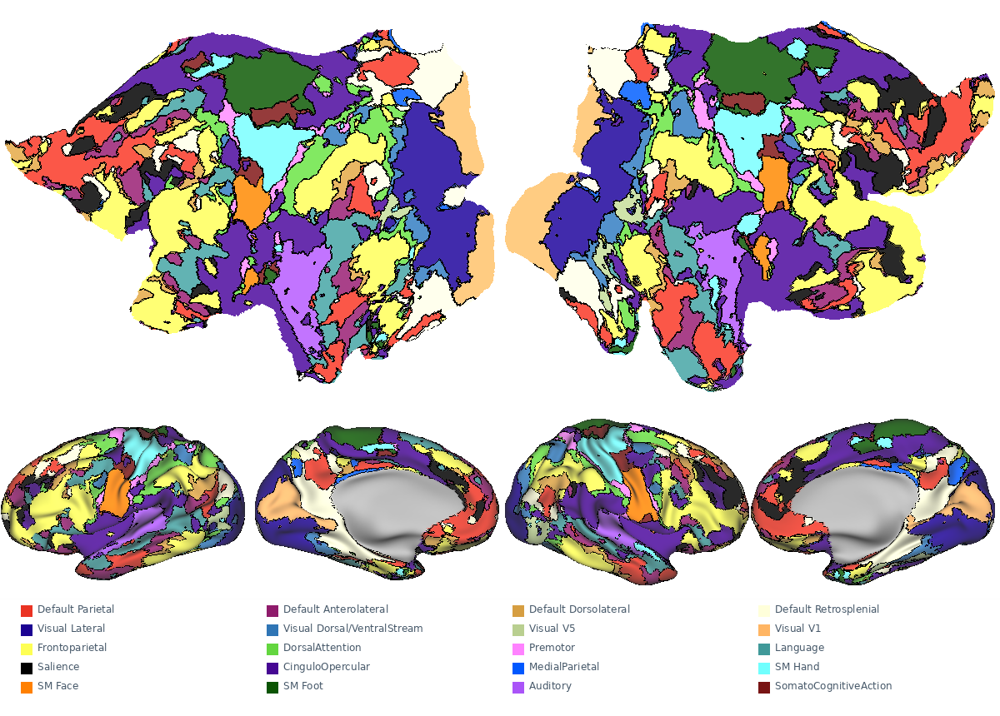
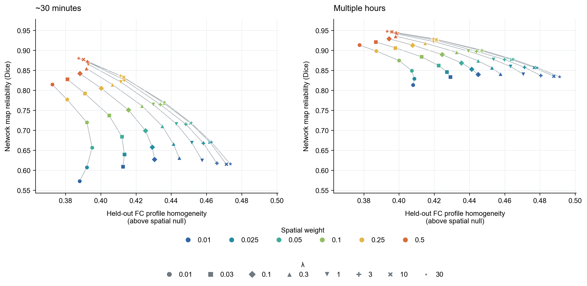
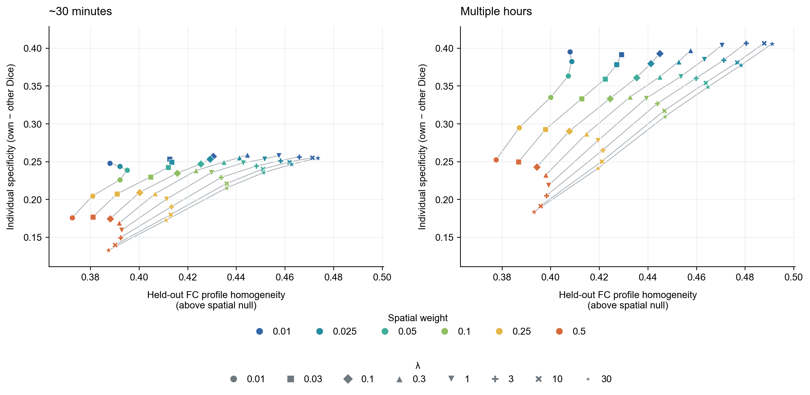
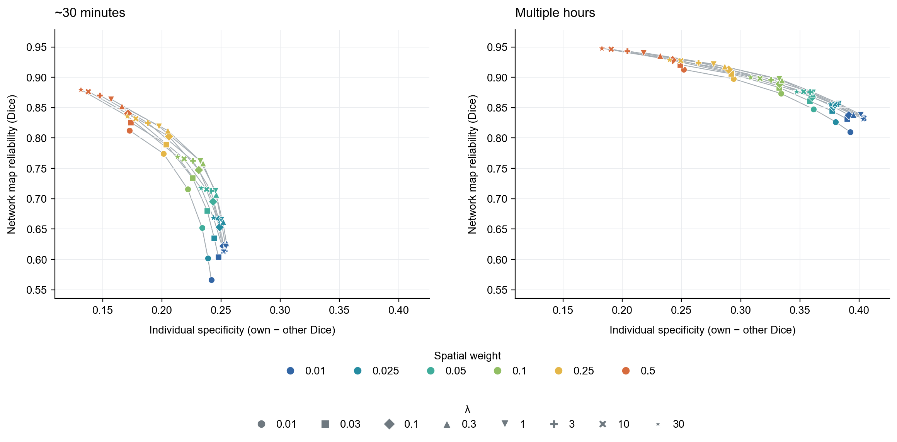

# Tradeoffs of incorporating spatial priors

RidgePFM combines an individual's FC evidence with a population spatial prior. Increasing spatial weight favors locations typical of the group; decreasing it gives individual FC more influence. λ changes the regularized fit to the network FC templates.

## What changes in the maps?

The example below uses the same subject and FC data throughout. Changing λ or spatial weight changes network assignments. Colors identify networks, rather than FC strength. Flat surfaces show the full cortical layout; inflated surfaces provide anatomical context.

[Explore the network maps](https://raw.githubusercontent.com/cjl2007/pfm-mefmri/main/docs/ridgepfm-explorer.zip).

## What changes across independent data?

Stronger priors can improve agreement between network labels estimated from separate data. They can also remove individual-specific organization supported by held-out FC.

Each point is a λ × spatial-weight combination, averaged across participants. Color indicates spatial weight; shape indicates λ. Lines connect spatial weights at a fixed λ. The panels use identical axes.

Moving up means more repeatable network labels. Moving right means greater **held-out FC profile homogeneity above the spatial null**: labels are fitted in training data, while within-network similarity of whole-brain FC profiles is calculated in held-out data. The mean score for rotated copies of the training map is subtracted. This tests how well the fitted network organization generalizes.

The two objectives favor different settings. A useful choice preserves individual-specific FC organization while providing adequate reliability of network maps.

[Reasonable parameter ranges](ridgepfm-parameter-ranges.md) · [Subject-specific CV](ridgepfm-cv-selection.md)

Does the map retain individual-specific information?

A repeatable map may still be dominated by the group prior. Individual specificity asks whether a person's map is closer to their own independent map than to other participants' maps, using the same parameters for every comparison.

Individual specificity is own-person Dice minus mean other-person Dice. Identical group-prior maps have zero specificity despite perfect reliability.

Cohort and evaluation

The cohort includes 20 highly sampled participants. FC panels use the same 19 participants with complete FC grids; map-only comparisons use all 20. Two session orientations are averaged within person. These figures describe fixed parameter combinations, rather than subject-specific CV selections. 

[Full analysis details](ridgepfm-cross-validation.md).

