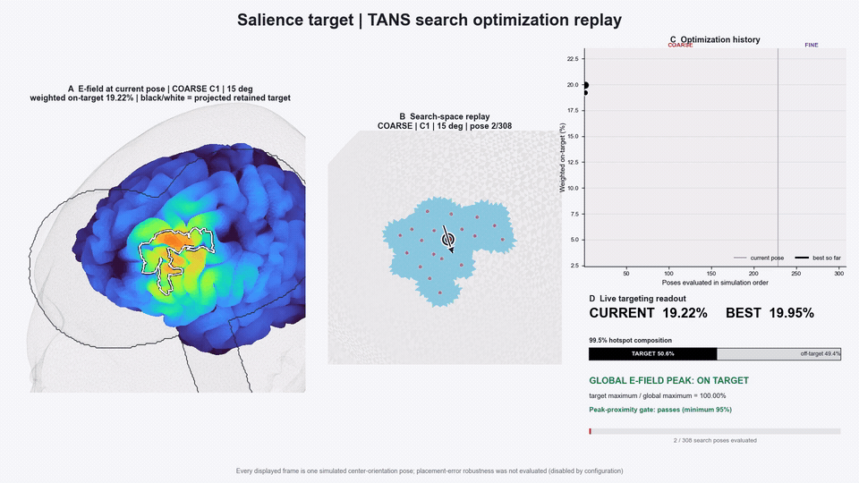

# Individualized TMS targeting

[PFM-TANS](https://github.com/cjl2007/pfm-tans) can follow processing and network
mapping as an optional final module. It uses the participant’s anatomy and
functional maps to model coil placement and review target and off-target exposure.

**Anatomy + network maps → head model → target preparation → coil search →
dose review → neuronavigation export.**

[Basic workflow and setup](https://github.com/cjl2007/pfm-tans#get-started) ·
[PFM-mefmri module configuration](../tans-integration.md)

## Coil-search movie

[Watch the full search movie](../assets/tans-search-replay.mp4).
This published Salience example replays saved simulations and ends at the selected
fine-search pose. Playback speed is independent of computation time.
[More examples and dose-review workflow](https://github.com/cjl2007/pfm-tans).

[Back to pfm-mefmri](../../README.md)
